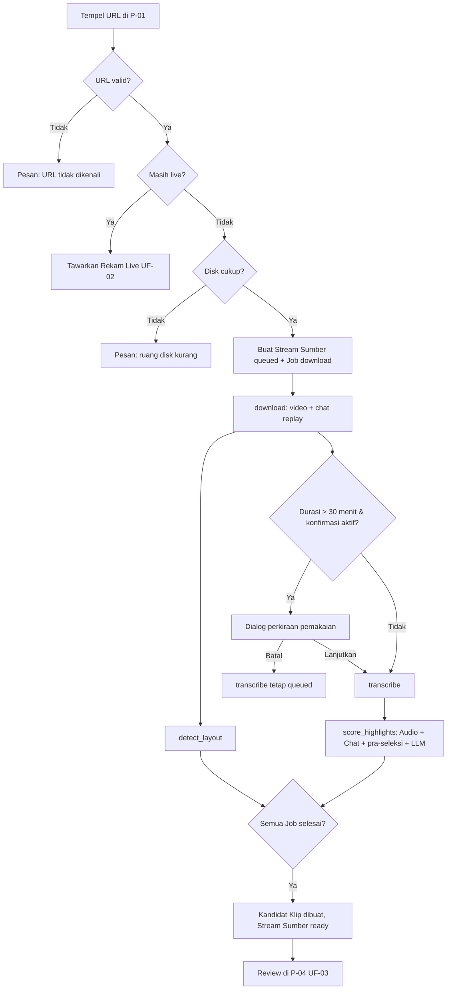
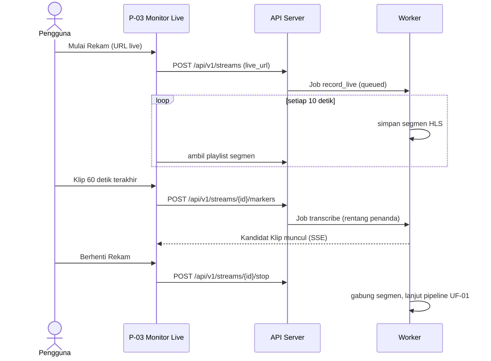
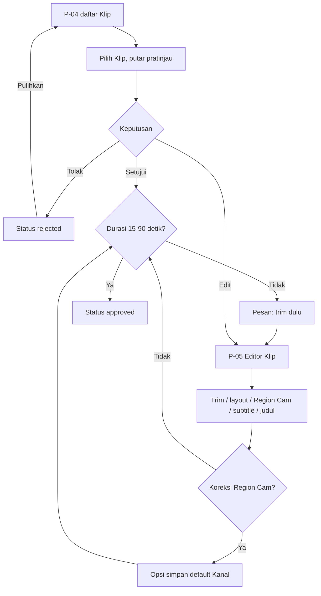
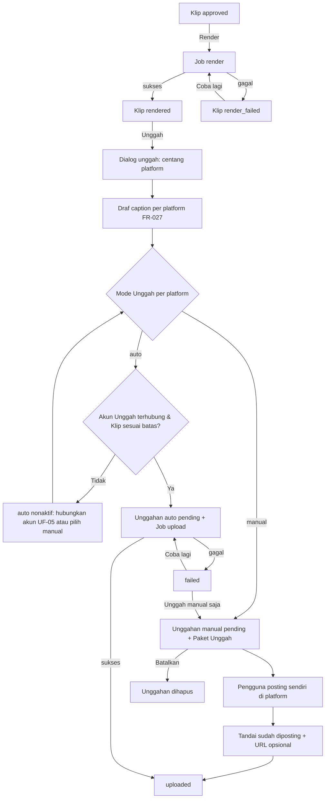
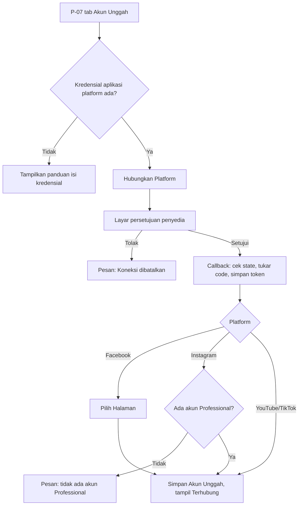
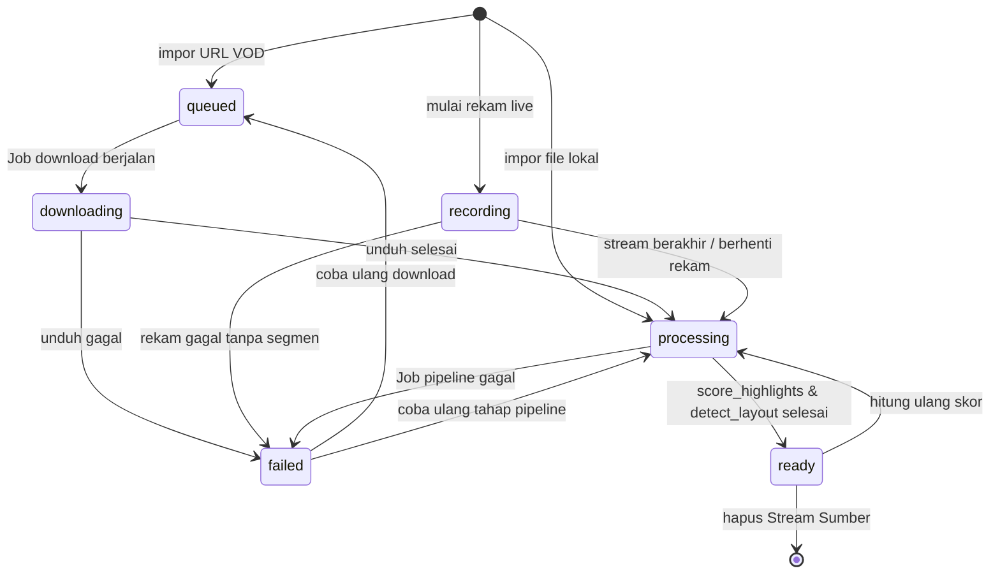
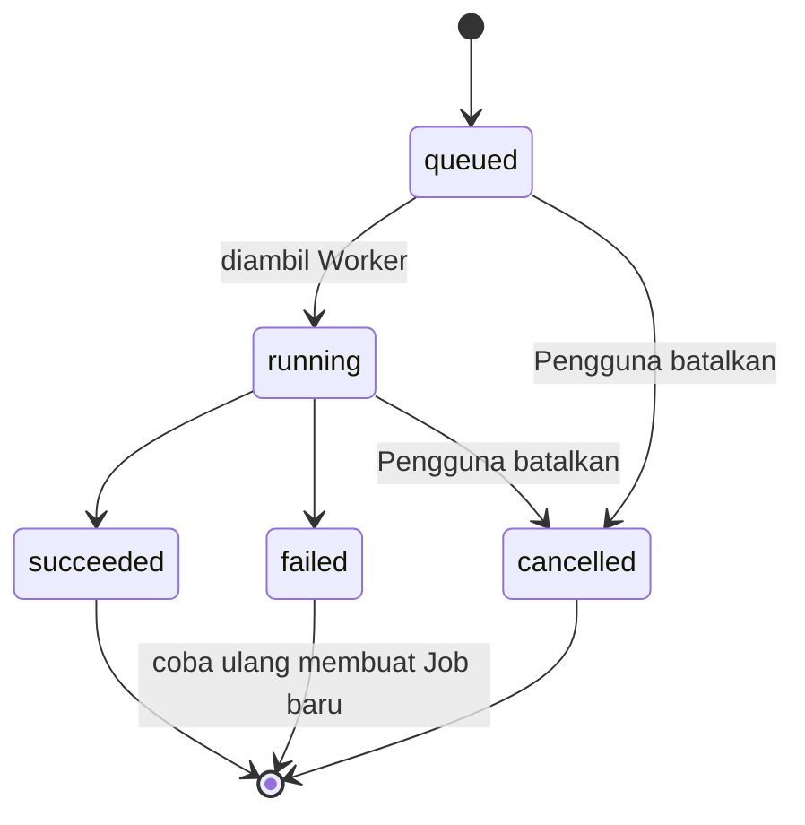
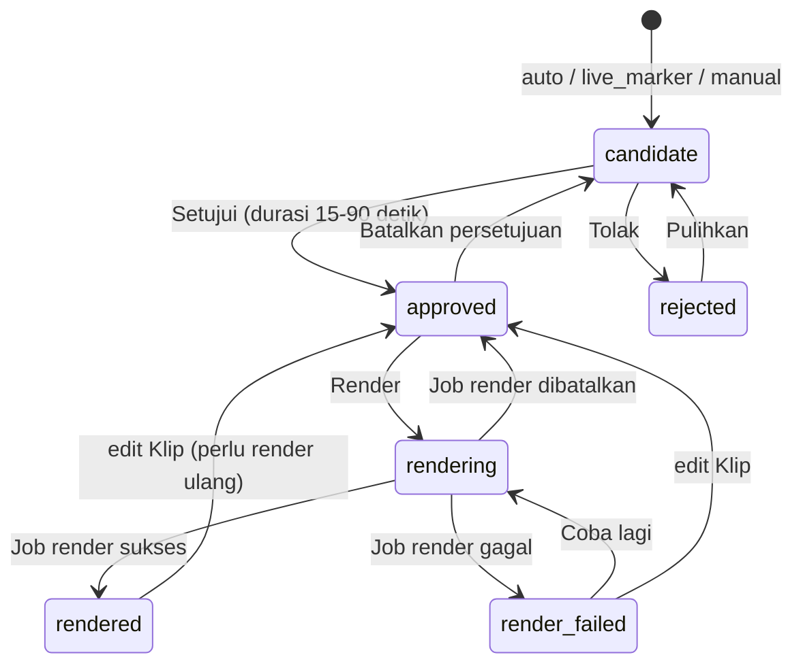
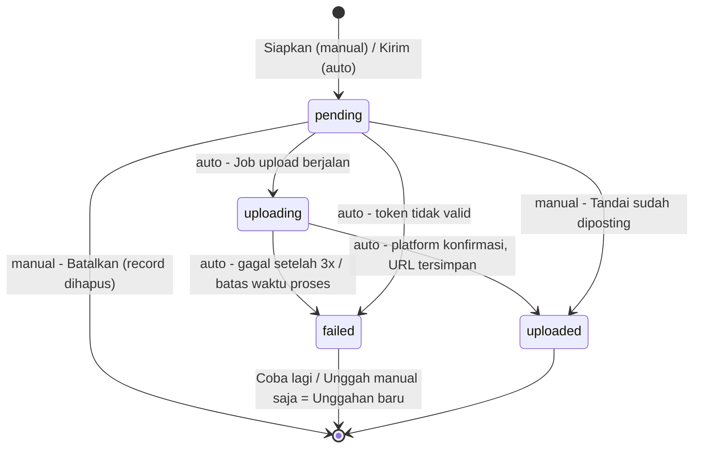

# User Flow & State: Klipin
> Versi 1.3 · 2026-11-21 · Status: Draf · Dokumen terkait: 01-prd.md, 02-requirements.md

## 1. Peta Alur per Peran
| Peran | Alur yang dijalankan |
|---|---|
| Pengguna | UF-01 Impor VOD & pipeline otomatis · UF-02 Rekam live & Penanda Live · UF-03 Review & edit Klip · UF-04 Render & unggah (manual/otomatis) · UF-05 Hubungkan Akun Unggah · UF-06 Pantau & coba ulang Job · UF-07 Impor file lokal · UF-08 Bersihkan penyimpanan |

Hanya ada satu peran (Pengguna) dan tidak ada login. Aplikasi dibuka di `http://127.0.0.1:8765` (atau `http://localhost:8765`).

## 2. Alur Utama

### UF-01 Impor VOD & pipeline otomatis (FR-001, FR-005, FR-006, FR-009–FR-012, FR-022)
1. Pengguna membuka P-01 Beranda, menempel URL VOD YouTube/Kick, lalu menekan "Impor".
2. Sistem memvalidasi URL dan mengambil metadata lewat yt-dlp (judul, Kanal, durasi, status live).
3. Jika URL masih live → tawarkan UF-02. Jika ruang disk kurang → tolak dengan pesan.
4. Sistem membuat/menemukan Kanal, membuat Stream Sumber (`queued`), lalu Job `download`.
5. Job `download` berjalan (Stream Sumber `downloading`): unduh video ≤ 1080p + chat replay (jika ada).
6. Selesai unduh → Stream Sumber `processing`. Sistem membuat Job `detect_layout` (langsung jalan) dan Job `transcribe`.
7. Jika durasi > 30 menit dan konfirmasi aktif → tampil dialog perkiraan pemakaian (FR-022). Job `transcribe` tetap `queued` sampai Pengguna menekan "Lanjutkan".
8. `transcribe` selesai → sistem membuat Job `score_highlights`: hitung Sinyal Audio, Sinyal Chat, pra-seleksi, Sinyal LLM, lalu gabung skor.
9. `score_highlights` dan `detect_layout` selesai → Kandidat Klip dibuat dengan Preset Layout tersaran → Stream Sumber `ready`.
10. Pengguna mendapat notifikasi di UI ("12 Kandidat Klip siap") dan masuk ke UF-03.

### UF-02 Rekam live & Penanda Live (FR-003, FR-004, FR-013)
1. Pengguna menempel URL live di P-01 lalu menekan "Mulai Rekam" (opsi "Analisis selama live" bisa dicentang).
2. Sistem membuat Stream Sumber (`recording`) + Job `record_live`, lalu membuka P-03 Monitor Live.
3. Segmen 10 detik disimpan terus; player near-live di P-03 memutar playlist segmen lokal (delay ±10–30 detik).
4. Saat ada momen seru, Pengguna menekan "Klip 60 detik terakhir" atau "Tandai Mulai" → "Tandai Selesai".
5. Sistem membuat Penanda Live + Klip `candidate` (`origin = live_marker`), menjalankan transkripsi khusus rentang itu, lalu menampilkan Klip di panel kanan P-03 (≤ 2 menit).
6. Jika "Analisis selama live" aktif: setiap blok 5 menit selesai → `transcribe` + `score_highlights` blok → Kandidat Klip `auto` ikut muncul.
7. Stream berakhir atau Pengguna menekan "Berhenti Rekam" → segmen digabung → Stream Sumber `processing` → lanjut ke UF-01 langkah 6 (blok yang sudah ditranskripsi tidak dikirim ulang).

### UF-03 Review & edit Klip (FR-014, FR-015, FR-016, FR-017, FR-008)
1. Pengguna membuka P-04 Review Klip pada sebuah Stream Sumber; daftar Klip diurutkan dari Skor Highlight tertinggi.
2. Pengguna memilih Klip → pratinjau 9:16 diputar dengan layout & subtitle.
3. Pengguna menekan "Tolak" (→ `rejected`) atau "Setujui" (→ `approved`), atau "Edit" untuk masuk P-05 Editor Klip.
4. Di P-05: trim (opsi jepret ke batas kalimat), ganti Preset Layout, geser Region Cam, pilih Gaya Subtitle & Bahasa Tampil, edit teks subtitle & judul. Perubahan tersimpan otomatis.
5. Jika Region Cam dikoreksi → Pengguna boleh mencentang "Simpan sebagai default Kanal ini" dan "Terapkan ke semua klip".
6. Pengguna menekan "Setujui" di P-05 → kembali ke P-04.
7. Pengguna juga bisa menambah Klip manual dengan memilih rentang di timeline P-04.

### UF-04 Render & unggah: manual atau otomatis (FR-018, FR-020, FR-025, FR-026, FR-027)
1. Di P-04, Pengguna menekan "Render" pada Klip `approved` atau "Render semua yang disetujui".
2. Sistem membuat Job `render` per Klip → Klip `rendering`.
3. Selesai → Klip `rendered`; tombol "Buka folder", "Unduh MP4", "Unduh .srt", dan "Unggah" aktif.
4. Pengguna menekan "Unggah" → dialog unggah dengan daftar Platform Tujuan (YouTube, TikTok, Instagram, Facebook). Platform yang sudah punya Unggahan aktif/berhasil ditampilkan dengan statusnya dan tidak bisa dipilih lagi (BR-009).
5. Pengguna mencentang platform. Sistem mengisi draf judul/caption/hashtag per platform (FR-027; dari cache jika sudah ada).
6. Per platform, Pengguna memilih Mode Unggah:
   - `manual` (default) — selalu tersedia.
   - `auto` — aktif hanya jika Akun Unggah platform terhubung dan Klip memenuhi batas platform (BR-013). Jika belum terhubung, tersedia tautan ke UF-05.
7. Pengguna meninjau/mengedit teks per platform (dan visibilitas untuk `auto`), lalu menekan "Siapkan & Kirim".
8. **Cabang manual:** Unggahan `manual`/`pending` dibuat → Paket Unggah tampil (Unduh MP4/.srt, Salin caption, Buka halaman upload platform) → Pengguna memposting sendiri di platform → kembali ke Klipin → "Tandai sudah diposting" (+ URL opsional) → `uploaded`. Atau "Batalkan" → Unggahan dihapus.
9. **Cabang otomatis:** Unggahan `auto`/`pending` + Job `upload` per platform → `uploading` → `uploaded` (URL postingan tampil) atau `failed` (tombol "Coba lagi" atau "Unggah manual saja").
10. Kartu Klip di P-04 menampilkan badge status per platform.

### UF-05 Hubungkan Akun Unggah (FR-019)
1. Pengguna membuka P-07 Pengaturan → tab "Akun Unggah". Setiap Platform Tujuan menampilkan status: "Belum dikonfigurasi" (kredensial aplikasi developer kosong; tampil panduan), "Belum terhubung", "Terhubung: {nama akun}", atau "Bermasalah: hubungkan ulang".
2. Pengguna menekan "Hubungkan {Platform}".
3. Browser membuka layar persetujuan penyedia: Google (YouTube), TikTok, atau Meta (Instagram & Facebook).
4. Penyedia me-redirect kembali ke Klipin (`/oauth/callback/{platform}`) dengan `code` & `state`.
5. Sistem memverifikasi `state`, menukar `code` dengan token, lalu menyimpan token di keyring OS.
6. Langkah khusus platform:
   - Facebook: Pengguna memilih satu Halaman.
   - Instagram: sistem mencari akun Instagram Professional yang terhubung. Jika tidak ada, tampil pesan "Tidak ada akun Instagram Professional yang terhubung ke akun ini."
7. P-07 menampilkan "Terhubung: {nama akun}".
8. Jika Pengguna menolak di layar penyedia → kembali ke P-07 dengan pesan "Koneksi dibatalkan."

### UF-06 Pantau & coba ulang Job (FR-023)
1. Indikator Job aktif selalu tampil di header; klik → P-06 Antrean Job.
2. P-06 menampilkan Job aktif (progres %, tahap) dan riwayat.
3. Job `failed` → Pengguna membaca pesan error → memperbaiki penyebab (mis. isi API key) → "Coba lagi" → Job baru dibuat dan melanjutkan dari checkpoint.
4. Job `queued`/`running` → "Batalkan" → `cancelled`.

### UF-07 Impor file lokal (FR-002)
1. Di P-01, Pengguna menekan "Pilih file" dan memilih video dari disk.
2. Sistem memvalidasi file (FFprobe), membuat Stream Sumber (`platform = local`, status `processing`), lalu lanjut ke UF-01 langkah 6.

### UF-08 Bersihkan penyimpanan (FR-024)
1. Di P-02 Daftar Stream, Pengguna melihat ukuran file per Stream Sumber.
2. Pilih "Hapus video sumber" atau "Hapus Stream Sumber" → dialog konfirmasi (menyebut jumlah Klip yang belum dirender) → hapus → tampil ukuran yang dibebaskan.

## 3. Alur Alternatif & Error
| Situasi | Perilaku sistem |
|---|---|
| yt-dlp gagal (situs berubah, video privat/dihapus, geo-block) | Job `download` `failed` dengan pesan dari yt-dlp yang diringkas. Saran: "Perbarui yt-dlp di Pengaturan" atau cek akses video |
| Koneksi internet putus saat unduh | yt-dlp melanjutkan unduhan parsial saat "Coba lagi" (tidak mulai dari nol) |
| Koneksi live putus < 60 detik | `record_live` menyambung ulang; celah dicatat. Putus ≥ 60 detik → rekaman dihentikan otomatis, segmen yang ada diproses |
| API transkripsi error sementara (timeout/5xx/429) | Coba ulang per potongan maks. 3× (backoff 2/4/8 detik); lebih dari itu → Job `failed`, potongan yang sukses tetap tersimpan |
| API key salah/kosong | Job `failed` sebelum mengirim data; pesan mengarah ke P-07 |
| LLM mengembalikan JSON tidak valid | Coba ulang 1×, lalu Sinyal LLM = null untuk jendela itu ("skor parsial") |
| Tidak ada wajah terdeteksi | Preset `center_crop` + pesan untuk menandai Region Cam manual |
| Tidak ada jendela dengan skor ≥ 40 | Stream Sumber tetap `ready` dengan 0 Kandidat Klip `auto`; tampil "Tidak ada momen menonjol. Coba turunkan ambang atau buat klip manual." |
| Terjemahan gagal | Bahasa Tampil kembali `source` + pesan |
| Render gagal | Klip `render_failed`, baris terakhir error FFmpeg ditampilkan, "Coba lagi" |
| Token platform (YouTube/TikTok/Meta) kedaluwarsa/dicabut | Job `upload` `failed`, Akun Unggah ditandai "Bermasalah", pesan "Koneksi {Platform} kedaluwarsa. Hubungkan ulang di Pengaturan."; opsi "Unggah manual saja" |
| Platform memproses video secara asinkron dan belum selesai | Job `upload` tetap `running` sambil memeriksa status publikasi berkala (interval & batas waktu per platform di 07-integrasi.md); melewati batas waktu → `failed` dengan pesan "Platform belum selesai memproses, cek di aplikasi {Platform}" |
| Platform memposting sebagai private karena aplikasi belum diaudit | Unggahan tetap `uploaded`, ditambah peringatan di kartu Klip "Diposting sebagai private oleh platform" |
| Pengguna lupa menandai Unggahan manual | Unggahan tetap `pending`; badge "Menunggu ditandai" di kartu Klip; tidak ada pengingat otomatis |
| Aplikasi ditutup saat Job berjalan | Saat start ulang, Job `running` → `failed` ("Terhenti karena aplikasi ditutup"); "Coba lagi" melanjutkan dari checkpoint. `record_live` yang terputus tidak bisa dilanjutkan ke timeline yang sama; segmen yang ada diproses |
| Pengguna membatalkan dialog perkiraan pemakaian | Job `transcribe` tetap `queued`; Stream Sumber tetap `processing` dengan banner "Menunggu konfirmasi transkripsi" |
| Disk penuh saat unduh/rekam/render | Job `failed` dengan pesan "Ruang disk habis"; file parsial dihapus kecuali unduhan yang bisa dilanjutkan |

## 4. State Entitas Penting

### 4.1 Stream Sumber (`source_streams.status`)

| Status | Arti | Transisi ke | Siapa yang boleh memicu |
|---|---|---|---|
| `queued` | Stream Sumber dibuat, menunggu Job `download` | `downloading` | Sistem |
| `downloading` | Video & chat sedang diunduh | `processing`, `failed` | Sistem |
| `recording` | Live sedang direkam | `processing`, `failed` | Sistem; Pengguna (Berhenti Rekam) |
| `processing` | Transkripsi/deteksi/skor berjalan atau menunggu konfirmasi | `ready`, `failed` | Sistem |
| `ready` | Kandidat Klip tersedia untuk direview | `processing` (hitung ulang skor) | Pengguna |
| `failed` | Ada tahap yang gagal dan belum dicoba ulang | `queued`, `processing` | Pengguna (Coba lagi) |

### 4.2 Job (`jobs.status`)

| Status | Arti | Transisi ke | Siapa yang boleh memicu |
|---|---|---|---|
| `queued` | Menunggu Worker (atau menunggu konfirmasi pemakaian) | `running`, `cancelled` | Sistem; Pengguna (batal) |
| `running` | Sedang dikerjakan Worker | `succeeded`, `failed`, `cancelled` | Sistem; Pengguna (batal) |
| `succeeded` | Selesai; memicu Job tahap berikutnya | — | Sistem |
| `failed` | Gagal; pesan error tersimpan | — (coba ulang = Job baru dengan `retry_of_job_id`) | Sistem |
| `cancelled` | Dibatalkan Pengguna | — | Pengguna |

### 4.3 Klip (`clips.status`)

| Status | Arti | Transisi ke | Siapa yang boleh memicu |
|---|---|---|---|
| `candidate` | Diusulkan sistem/Penanda Live/manual, belum direview | `approved`, `rejected` | Pengguna |
| `approved` | Disetujui, siap render | `rendering`, `candidate` | Pengguna |
| `rejected` | Ditolak, disembunyikan dari filter default | `candidate` | Pengguna |
| `rendering` | Job `render` (final) berjalan; render pratinjau tidak mengubah status | `rendered`, `render_failed`, `approved` (dibatalkan) | Sistem; Pengguna (batalkan Job) |
| `rendered` | MP4 + .srt tersedia | `approved` (jika diedit) | Pengguna |
| `render_failed` | Render gagal | `rendering`, `approved` | Pengguna |

### 4.4 Unggahan (`uploads.status`)

| Status | Arti | Transisi ke | Siapa yang boleh memicu |
|---|---|---|---|
| `pending` | `auto`: menunggu Job. `manual`: Paket Unggah siap, menunggu Pengguna memposting | `uploading`, `failed` (auto); `uploaded`, dihapus (manual) | Sistem (auto); Pengguna (manual) |
| `uploading` | `auto` saja: file sedang diunggah / platform sedang memproses | `uploaded`, `failed` | Sistem |
| `uploaded` | Postingan ada di platform (dikonfirmasi API, atau ditandai Pengguna untuk manual) | — | Sistem (auto); Pengguna (manual) |
| `failed` | `auto` saja: gagal; boleh unggah ulang (BR-009) | — | Sistem |

## Keputusan implementasi (disetujui pemilik 2026-11-21)
Keputusan yang diambil saat implementasi karena spesifikasi belum merinci; nomor K-xx sama dengan riwayat di `docs/CATATAN-SESI.md`.

- **K-2** Membatalkan Job pipeline (download/transcribe/detect_layout/score_highlights seluruh stream) membuat Stream Sumber `failed` dengan pesan "Job dibatalkan." State machine §4.1 tidak mengatur ini; tanpanya stream tertahan di `downloading`/`processing` _(kode: `backend/klipin/jobs.py` (`cancel_job`))_

## Asumsi & Pertanyaan Terbuka
- [ASUMSI] Port lokal default 8765 (bisa diubah di konfigurasi).
- [ASUMSI] Delay player near-live ±10–30 detik dapat diterima untuk penandaan momen.
- [ASUMSI] "Coba lagi" membuat Job baru yang merujuk Job lama (`retry_of_job_id`) agar riwayat kegagalan tetap ada.
- [ASUMSI] Rekaman live yang terputus karena aplikasi ditutup tidak disambung ke timeline yang sama; Pengguna bisa memulai rekam baru sebagai Stream Sumber terpisah.
- [TANYA] Apakah perlu notifikasi desktop (OS) saat pipeline selesai, selain notifikasi di UI? (Pengguna)

## Riwayat Perubahan
| Versi | Tanggal | Perubahan |
|---|---|---|
| 1.3 | 2026-11-21 | Keputusan implementasi disetujui pemilik (K-2): pembatalan Job pipeline membuat Stream Sumber `failed` |
| 1.0 | 2026-11-20 | Draf awal |
| 1.2 | 2026-11-20 | Hasil CEK #6: transisi Klip `rendering → approved` saat Job render dibatalkan; catatan render pratinjau tidak mengubah status |
| 1.1 | 2026-11-20 | Menyesuaikan unggah multi-platform & Mode Unggah (01-prd.md v1.1): UF-04 cabang manual/otomatis, UF-05 Hubungkan Akun Unggah per platform, alur error unggah, state Unggahan untuk mode manual |
