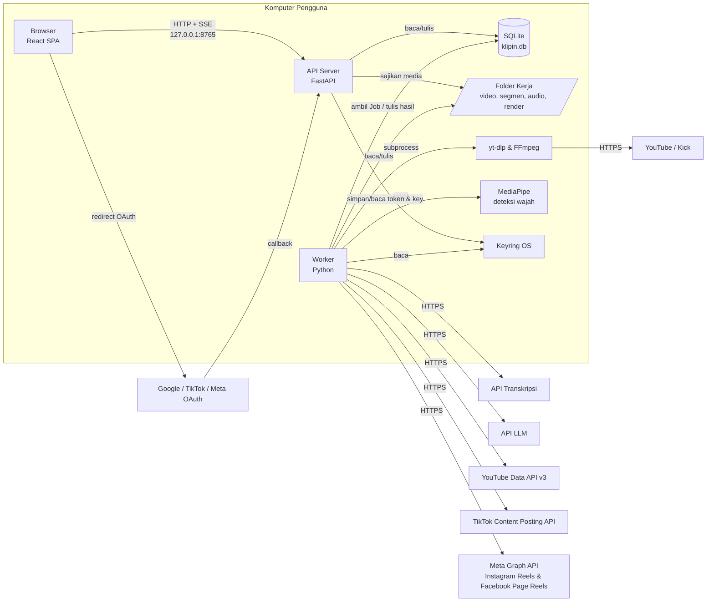
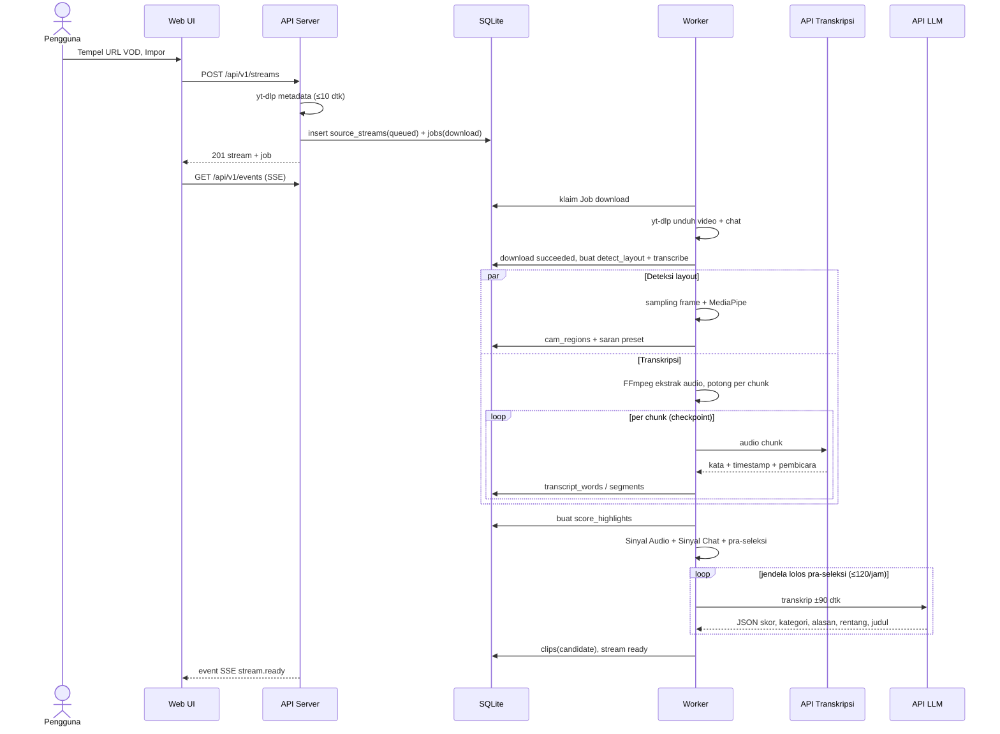
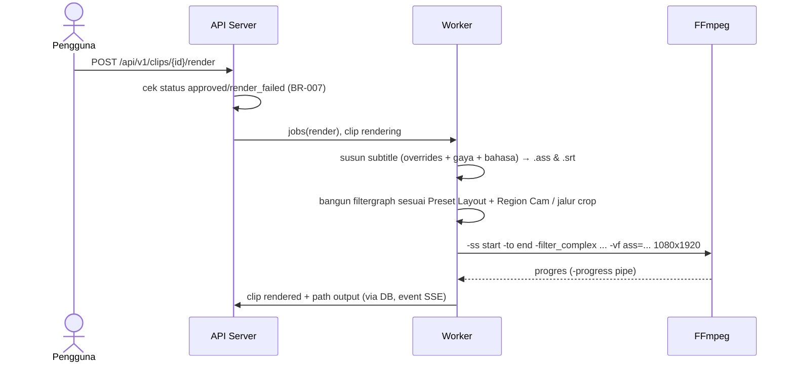

# Arsitektur Sistem: Klipin
> Versi 1.3 · 2026-11-21 · Status: Draf · Dokumen terkait: 01-prd.md, 02-requirements.md, 03-user-flow.md, 07-integrasi.md

## 1. Gambaran Umum
Klipin adalah **monolith lokal** dengan dua proses Python yang berbagi satu database SQLite dan satu folder kerja:
1. **API Server** (FastAPI): menyajikan UI (file statis hasil build React), REST API `/api/v1`, stream progres (SSE), file media lokal, dan callback OAuth.
2. **Worker**: mengambil Job dari tabel `jobs` lalu menjalankan pekerjaan berat (yt-dlp, FFmpeg, deteksi wajah, panggilan API transkripsi/LLM, unggah otomatis ke YouTube/TikTok/Instagram/Facebook).

Keduanya dijalankan oleh satu perintah (`klipin start`). API hanya mendengarkan di alamat loopback `127.0.0.1` dan `::1` (BR-012), sehingga `http://localhost:8765` tetap bekerja walau `localhost` resolve ke IPv6.



## 2. Komponen & Tanggung Jawab
| Komponen | Tanggung jawab | Teknologi |
|---|---|---|
| Web UI | Halaman P-01–P-07 (08-ui-ux.md): impor, monitor live, review & editor Klip, antrean Job, pengaturan. Pratinjau layout memakai CSS crop di atas `<video>`; player live memakai hls.js | React 18 + Vite + TypeScript, TanStack Query, hls.js, Tailwind CSS |
| API Server | Validasi input, CRUD entitas, membuat Job, SSE progres, menyajikan file media dengan HTTP Range, OAuth callback, membaca/menulis Pengaturan | Python 3.11+, FastAPI, Uvicorn, Pydantic v2, SQLAlchemy 2 + Alembic |
| Worker | Loop: klaim Job `queued` paling lama (sesuai batas paralel), jalankan handler per Jenis Job, tulis progres/checkpoint, buat Job tahap berikutnya | Python, proses terpisah, `subprocess` untuk yt-dlp/FFmpeg |
| Orkestrator Pipeline | Aturan "Job X sukses → buat Job Y" (bagian 3.1) dalam satu transaksi dengan penandaan `succeeded` | Modul `pipeline.py` di Worker |
| Pengambil Media | Metadata, unduh VOD, chat replay, rekam live HLS per segmen | yt-dlp (sebagai library/CLI), FFmpeg |
| Analis Layout | Sampling frame, deteksi wajah, pengelompokan posisi, saran Preset Layout, jalur crop (IRL/podcast) | OpenCV, MediaPipe Face Detection, NumPy |
| Analis Highlight | Sinyal Audio (loudness), Sinyal Chat, pra-seleksi, panggilan LLM, gabung skor, buat Kandidat Klip | NumPy, FFmpeg `ebur128`/`astats`, adapter LLM |
| Adapter Transkripsi | Antarmuka `Transcriber.transcribe(audio_chunk) -> words, segments, language, speakers`; implementasi per penyedia | Python `Protocol` + `httpx`; penyedia dipilih di 07-integrasi.md |
| Adapter LLM | Antarmuka `HighlightJudge.score(window)` dan `Translator.translate(lines)`; validasi JSON | Python `Protocol` + SDK penyedia + Pydantic |
| Perender | Bangun filtergraph FFmpeg per Preset Layout, buat file ASS dari subtitle Klip, render MP4 1080×1920 + .srt | FFmpeg (libx264, libass) |
| Pengunggah | Antarmuka `Publisher` per Platform Tujuan: `limits()` (durasi/ukuran/caption/visibilitas yang diizinkan), `start_oauth()`/`finish_oauth()`, `publish(clip, upload)` (unggah + tunggu status publikasi), `revoke()`. Implementasi: `YouTubePublisher`, `TikTokPublisher`, `InstagramPublisher`, `FacebookPublisher` (07-integrasi.md) | `google-api-python-client`, `httpx` (TikTok & Meta Graph API) |
| Paket Unggah | Menyusun Paket Unggah manual: path MP4/.srt, caption + hashtag + template, tautan halaman upload resmi platform | Modul `publishing/manual.py` (tanpa jaringan) |
| Penulis Caption | Draf judul/caption/hashtag per platform via Adapter LLM (FR-027) | Adapter LLM (`CaptionWriter`) |
| Penyimpanan Rahasia | API key & refresh token di keyring OS; fallback file `.env` lokal (dengan peringatan) | `keyring` |
| Database | Metadata semua entitas + antrean Job | SQLite (mode WAL) |
| Folder Kerja | File besar: video sumber, segmen live, audio, frame sampel, ASS, MP4 output | Disk lokal |

## 3. Alur Data Kritis

### 3.1 Pipeline Job
| Job selesai (`succeeded`) | Job berikut yang dibuat | Catatan |
|---|---|---|
| `download` | `detect_layout`, `transcribe` | `transcribe` tertahan konfirmasi pemakaian (FR-022) bila berlaku |
| `record_live` (stream berakhir/berhenti) | `detect_layout`, `transcribe` (hanya rentang yang belum ditranskripsi) | Segmen digabung dulu di dalam `record_live` |
| `transcribe` (seluruh Stream Sumber) | `score_highlights` | Sinyal Audio/Chat dihitung di dalam `score_highlights` |
| `transcribe` (rentang Penanda Live / blok live) | `score_highlights` scope blok (hanya jika blok live) | Untuk Penanda Live, Klip sudah ada; cukup subtitle |
| `score_highlights` + `detect_layout` keduanya sukses | — | Stream Sumber → `ready` |
| `render` (`purpose = final`) | — | Klip → `rendered` |
| `render` (`purpose = preview`) | — | Tidak mengubah status Klip; hasil di `streams/{id}/previews/clip_{clip_id}.mp4` |
| `upload` | — | Unggahan → `uploaded` |

Klaim Job oleh Worker memakai satu transaksi:
```sql
UPDATE jobs SET status='running', started_at=:now, worker_heartbeat_at=:now
WHERE id = (SELECT id FROM jobs
            WHERE status='queued' AND awaiting_confirmation=0
            ORDER BY priority DESC, created_at ASC LIMIT 1)
  AND status='queued'
RETURNING id;
```
Worker memperbarui `worker_heartbeat_at` tiap 10 detik. Saat start, Job `running` dengan heartbeat > 60 detik ditandai `failed` ("Terhenti karena aplikasi ditutup").

### 3.2 Impor VOD sampai Kandidat Klip


### 3.3 Render Klip


## 4. Tech Stack
| Layer | Pilihan | Alasan | Alternatif yang ditolak & alasannya |
|---|---|---|---|
| Frontend | React 18 + Vite + TypeScript, Tailwind, TanStack Query, hls.js | Editor Klip interaktif (timeline, drag Region Cam) butuh SPA; Vite build statis cukup disajikan FastAPI | Next.js: SSR/route server tidak dibutuhkan untuk app lokal 1 pengguna. HTMX/Jinja: editor timeline & drag area terlalu interaktif |
| Backend/API | Python 3.11+, FastAPI, Uvicorn, Pydantic v2 | Ekosistem video/AI Python paling matang; FastAPI ringan & tipe kuat | Node.js: library deteksi wajah & tooling audio kurang matang. Django: fitur admin/auth tidak dipakai |
| Antrean Job | Tabel `jobs` di SQLite + proses Worker | 1 pengguna, beban kecil; tanpa server tambahan | Celery + Redis: menambah layanan yang harus dipasang/dijalankan. RQ/Huey: bisa dipertimbangkan nanti, tetapi tabel `jobs` juga dipakai untuk progres/riwayat di UI |
| Database | SQLite (WAL) + SQLAlchemy 2 + Alembic | Lokal, nol konfigurasi, mudah dicadangkan (satu file) | PostgreSQL: butuh server terpisah tanpa manfaat untuk 1 pengguna |
| Progres real-time | Server-Sent Events (`GET /api/v1/events`) | Satu arah server→browser sudah cukup; lebih sederhana dari WebSocket | WebSocket: tidak ada kebutuhan dua arah. Polling: boros & lambat |
| Ambil media | yt-dlp + FFmpeg | Mendukung YouTube & Kick, VOD & live, chat replay YouTube | API resmi YouTube: tidak menyediakan unduhan video |
| Deteksi wajah | MediaPipe Face Detection + OpenCV (lokal, CPU) | Cepat di CPU, gratis, cukup akurat untuk facecam | API vision cloud: biaya per frame & latensi. YOLO: lebih berat, tidak perlu untuk wajah |
| Transkripsi | API cloud dengan timestamp per kata + diarization, lewat adapter | Sesuai pilihan Pengguna (API); tidak butuh GPU | Whisper lokal: lambat tanpa GPU; bisa jadi adapter tambahan nanti |
| LLM | API LLM (mis. Claude) lewat adapter, output JSON tervalidasi | Penilaian konteks humor/hype & terjemahan butuh model bahasa kuat | Klasifikasi berbasis kata kunci saja: tidak menangkap konteks |
| Subtitle & render | File ASS + FFmpeg libass, libx264 preset `veryfast` | ASS mendukung karaoke/highlight per kata; satu langkah render | MoviePy: lebih lambat & memakai FFmpeg juga di bawahnya. Remotion: menambah runtime Node |
| Unggah | Mode `manual` (Paket Unggah) sebagai default; mode `auto` via API resmi: YouTube Data API v3, TikTok Content Posting API (Direct Post, `FILE_UPLOAD`), Instagram Graph API (Reels, resumable upload), Facebook Pages Reels Publishing API. OAuth 2.0 per platform dengan redirect `localhost` | Jalur resmi per platform; manual selalu bisa saat API dibatasi (aplikasi belum diaudit) | Otomasi browser / API tidak resmi: rapuh & melanggar ToS. Layanan pihak ketiga penjadwal posting: menambah biaya & ketergantungan, tidak perlu untuk 1 Pengguna |
| Rahasia | `keyring` (Windows Credential Manager / macOS Keychain) | Key tidak tersimpan teks polos di disk | File `.env` saja: fallback, dengan peringatan |
| Kemasan & menjalankan | `uv` untuk dependensi Python, `pnpm` untuk build UI, perintah `klipin` | Instalasi reproducible | Docker: akses GPU/FFmpeg/keyring di Windows lebih rumit untuk pengguna tunggal |
| Logging | `structlog` JSON ke `logs/klipin.log` (rotasi 10 MB × 5) | Debug Job tanpa alat tambahan | Sentry: tidak perlu untuk app lokal |

## 5. Keputusan Arsitektur (ADR)

### ADR-001 Aplikasi web lokal, bukan desktop atau SaaS
- **Konteks:** Dipakai sendiri, butuh UI review video yang kaya, proses berat di mesin sendiri.
- **Keputusan:** FastAPI menyajikan SPA React di `127.0.0.1:8765`; dibuka di browser biasa.
- **Konsekuensi:** (+) Satu basis kode, UI web modern, tanpa hosting. (−) Pengguna harus menjalankan perintah start; tidak bisa diakses dari HP (disengaja, BR-012).

### ADR-002 Antrean Job di SQLite, tanpa message broker
- **Konteks:** Pekerjaan berjalan lama (menit–jam), perlu progres, coba ulang, dan riwayat.
- **Keputusan:** Tabel `jobs` + satu proses Worker dengan klaim atomik dan heartbeat. Paralelisme diatur `max_heavy_jobs` (default 1) ditambah 1 slot ringan untuk Job `upload`/transkripsi rentang Penanda Live agar tidak menunggu render panjang.
- **Konsekuensi:** (+) Tidak ada Redis/Celery; mudah diinspeksi. (−) Tidak cocok untuk banyak Worker di banyak mesin. Jika suatu saat jadi SaaS, ganti ke antrean khusus.

### ADR-003 Transkripsi & LLM via adapter penyedia
- **Konteks:** Harga, kualitas Bahasa Indonesia, dan dukungan diarization berbeda antar penyedia dan bisa berubah.
- **Keputusan:** Antarmuka `Transcriber`, `HighlightJudge`, `Translator`; penyedia dipilih di Pengaturan. Hasil transkripsi disimpan permanen agar tidak perlu dibayar ulang.
- **Konsekuensi:** (+) Ganti penyedia tanpa ubah pipeline; bisa tambah Whisper lokal nanti. (−) Perlu normalisasi format respons tiap penyedia.

### ADR-004 Deteksi wajah lokal dengan sampling, layout ditentukan per Klip
- **Konteks:** Facecam gaming hampir selalu statis; IRL/podcast butuh crop dinamis.
- **Keputusan:** `detect_layout` menyampel 1 frame/10 detik untuk seluruh Stream Sumber (menentukan Region Cam statis & preset). Untuk preset dinamis (`irl`, `podcast`), jalur crop dihitung saat render dengan sampling lebih rapat (5 fps) hanya di rentang Klip, lalu dihaluskan.
- **Konsekuensi:** (+) Murah untuk stream panjang. (−) Render preset dinamis sedikit lebih lama.

### ADR-005 Subtitle dirender dengan ASS + FFmpeg
- **Konteks:** Butuh highlight per kata dan gaya yang bisa diatur.
- **Keputusan:** Subtitle Klip dikonversi ke ASS (tag `\k`/override warna per kata untuk `word_highlight`) lalu di-burn via filter `ass`. File .srt dibuat terpisah dari data yang sama.
- **Konsekuensi:** (+) Satu kali encode, hasil konsisten. (−) Pratinjau di browser adalah tiruan CSS, bukan hasil libass; bisa sedikit berbeda (font/posisi). Mitigasi: tombol "Pratinjau render 5 detik".

### ADR-006 Waktu media dalam milidetik relatif
- **Konteks:** Data dari banyak sumber (kata, chat, penanda, klip) harus sejajar.
- **Keputusan:** Semua posisi media disimpan sebagai integer `*_ms` relatif awal Stream Sumber (BR-010). Untuk live, timeline dimulai dari segmen pertama yang terekam.
- **Konsekuensi:** (+) Tidak ada drift float. (−) Chat live perlu dikonversi dari waktu wall-clock ke offset rekaman.

### ADR-007 Rahasia di keyring OS
- **Konteks:** API key dan token OAuth (Google, TikTok, Meta) memberi akses berbayar & akses posting ke akun Pengguna.
- **Keputusan:** Simpan di keyring OS dengan service `klipin`; DB hanya menyimpan referensi/metadata. Fallback `.env` jika keyring tidak tersedia, dengan banner peringatan.
- **Konsekuensi:** (+) Tidak bocor lewat backup DB atau repo. (−) Pindah komputer berarti mengisi ulang key/menghubungkan ulang semua Akun Unggah.

### ADR-008 Unggah manual sebagai default, otomatis lewat adapter per platform
- **Konteks:** Semua platform tujuan membatasi posting via API untuk aplikasi yang belum diaudit (YouTube & TikTok memaksa private; Meta butuh akun Professional/Halaman dan izin aplikasi). Pengguna tetap ingin opsi otomatis.
- **Keputusan:** Mode Unggah dipilih per Klip per platform; default `manual` (Paket Unggah). Mode `auto` memakai antarmuka `Publisher` yang sama untuk keempat platform; setiap adapter mendeklarasikan batas & visibilitas yang diizinkan (dibaca UI untuk menonaktifkan opsi yang tidak valid). Unggahan `auto` adalah Job ringan (`is_heavy = 0`) agar tidak tertahan render.
- **Konsekuensi:** (+) Klipin tetap berguna walau semua API dibatasi; platform baru cukup tambah adapter. (−) Pengguna harus membuat aplikasi developer sendiri di Google/TikTok/Meta untuk mode `auto`; perubahan API platform membutuhkan pembaruan adapter.

### ADR-009 Proteksi API lokal dengan token sesi
- **Konteks:** Server di `127.0.0.1` tetap bisa dipanggil oleh halaman web lain yang dibuka di browser yang sama (CSRF/DNS rebinding).
- **Keputusan:** Token acak per start disisipkan ke `index.html`; semua `/api/v1/*` wajib header `X-Klipin-Token`; media & SSE memakai `?t=`; header `Host` wajib `127.0.0.1`/`localhost`; tanpa CORS. Callback OAuth dikecualikan dan dilindungi `state` sekali pakai (06-api.md).
- **Konsekuensi:** (+) Situs lain tidak bisa memicu impor/unggah/hapus. (−) Tab lama perlu reload setelah Klipin di-restart.

## 6. Struktur Folder Proyek
```
klipin/
├── pyproject.toml              # dependensi Python (uv), entry point `klipin`
├── alembic.ini
├── .env.example
├── backend/
│   └── klipin/
│       ├── __main__.py         # CLI: start | worker | api | doctor | update-ytdlp
│       ├── config.py           # baca env + pengaturan DB
│       ├── db/
│       │   ├── models.py       # SQLAlchemy (05-database.md)
│       │   ├── session.py      # SQLite WAL, foreign_keys=ON
│       │   └── migrations/     # Alembic
│       ├── api/
│       │   ├── app.py          # FastAPI, mount SPA statis
│       │   ├── routes/         # streams, clips, jobs, markers, presets, styles, settings, uploads, events, media, oauth
│       │   └── schemas/        # Pydantic request/response (06-api.md)
│       ├── worker/
│       │   ├── loop.py         # klaim Job, heartbeat, batas paralel
│       │   ├── pipeline.py     # aturan Job berikutnya (bagian 3.1)
│       │   └── handlers/       # download.py, record_live.py, transcribe.py, detect_layout.py,
│       │                       # score_highlights.py, render.py, upload.py
│       ├── media/              # ytdlp.py, ffmpeg.py (filtergraph), probe.py
│       ├── layout/             # face_detect.py, regions.py, crop_path.py, presets.py
│       ├── highlight/          # audio_signal.py, chat_signal.py, preselect.py, scoring.py
│       ├── subtitles/          # build.py, ass.py, srt.py, translate.py
│       ├── providers/          # transcriber/ (base.py + per penyedia), llm/ (base.py + per penyedia)
│       ├── publishing/         # base.py (Publisher), youtube.py, tiktok.py, instagram.py, facebook.py,
│       │                       # oauth.py (state/PKCE bersama), manual.py (Paket Unggah), captions.py
│       ├── secrets.py          # keyring wrapper
│       └── logging.py
├── frontend/
│   ├── package.json
│   ├── vite.config.ts
│   └── src/
│       ├── main.tsx
│       ├── api/                # klien API + hook SSE
│       ├── pages/              # P-01 … P-07 (08-ui-ux.md)
│       ├── components/         # Player9x16, Timeline, RegionCamEditor, SubtitleEditor, JobBadge
│       └── styles/
├── tests/                      # unit & integrasi (09-testing.md), fixtures/ video pendek
└── docs/spec/                  # dokumen spesifikasi ini
```

Folder kerja (default `~/Klipin`, bisa diubah):
```
~/Klipin/
├── klipin.db                   # + klipin.db-wal
├── backups/                    # klipin-YYYYMMDD.db (7 terakhir, NFR-010)
├── streams/{stream_id}/
│   ├── source.mp4              # video sumber / hasil gabung live
│   ├── segments/               # segmen live sementara (NFR-011)
│   ├── audio/                  # chunk audio 16 kHz
│   ├── chat.json               # chat replay mentah
│   └── frames/                 # frame sampel deteksi (dihapus setelah detect_layout)
├── output/                     # MP4 + .srt hasil render
└── logs/klipin.log
```

## 7. Skalabilitas & Batas Desain
- Dirancang untuk **1 pengguna, 1 mesin**, Stream Sumber ≤ 8 jam, ≤ 200 Klip per Stream Sumber, ≤ 500 Stream Sumber tersimpan.
- Batas utama ada di disk (VOD 1080p 8 jam bisa > 10 GB) dan CPU saat render. Mitigasi: F-14 penyimpanan, `max_heavy_jobs`, FFmpeg preset `veryfast`.
- Tabel `transcript_words` bisa mencapai ±70.000 baris per jam audio; SQLite dengan index `(stream_id, start_ms)` masih nyaman sampai jutaan baris.
- **Tanda perlu desain ulang:** ingin dipakai beberapa orang/online (butuh auth, PostgreSQL, antrean khusus, object storage); ingin memproses beberapa live sekaligus terus-menerus (butuh Worker paralel lebih banyak); ingin transkripsi lokal real-time (butuh GPU).

## 8. Deployment (instalasi & menjalankan lokal)
Paket ini tidak punya dokumen Deployment terpisah karena aplikasi hanya berjalan lokal.

### 8.1 Prasyarat
| Komponen | Versi minimum | Cara cek |
|---|---|---|
| Python | 3.11 | `python --version` |
| uv | terbaru | `uv --version` |
| Node.js + pnpm (hanya untuk build UI) | Node 20 LTS | `node -v`, `pnpm -v` |
| FFmpeg + FFprobe (dengan libx264 & libass) | 6.0 | `ffmpeg -version` |
| Ruang disk kosong | ≥ 50 GB disarankan | — |

`klipin doctor` memeriksa semua prasyarat, versi yt-dlp, akses keyring, dan konektivitas API.

### 8.2 Variabel lingkungan / konfigurasi
| Nama | Contoh (bukan nilai asli) | Wajib | Dipakai oleh | Keterangan |
|---|---|---|---|---|
| `KLIPIN_HOME` | `C:\Users\nama\Klipin` | Tidak | API, Worker | Folder kerja; default `~/Klipin` |
| `KLIPIN_PORT` | `8765` | Tidak | API | Port lokal |
| `KLIPIN_HOST` | `127.0.0.1,::1` | Tidak | API | Daftar alamat loopback yang di-bind. Jangan diubah ke `0.0.0.0` (BR-012) |
| `KLIPIN_FFMPEG_PATH` | `C:\ffmpeg\bin\ffmpeg.exe` | Tidak | Worker | Jika FFmpeg tidak ada di PATH |
| `KLIPIN_MAX_HEAVY_JOBS` | `1` | Tidak | Worker | Bisa juga diatur di Pengaturan |
| `KLIPIN_TRANSCRIBER` | `deepgram` | Tidak | Worker | Cadangan saja: dipakai hanya bila Pengaturan `transcriber_provider` kosong. Pengaturan (P-07) selalu menang (ADR-003) |
| `KLIPIN_LLM_PROVIDER` | `anthropic` | Tidak | Worker | Cadangan saja: dipakai hanya bila Pengaturan `llm_provider` kosong. Pengaturan selalu menang |
| `TRANSCRIBER_API_KEY` | `xxxx` | Ya* | Worker | *Hanya jika keyring tidak tersedia; normalnya diisi lewat Pengaturan |
| `LLM_API_KEY` | `xxxx` | Ya* | Worker | *Sama seperti di atas |
| `GOOGLE_OAUTH_CLIENT_ID` | `1234-abc.apps.googleusercontent.com` | Untuk YouTube `auto` (F-11) | API, Worker | OAuth client tipe Desktop dari Google Cloud Console |
| `GOOGLE_OAUTH_CLIENT_SECRET` | `xxxx` | Untuk YouTube `auto` | API, Worker | Untuk client Desktop, secret ini tidak dianggap rahasia kuat; tetap jangan di-commit |
| `TIKTOK_CLIENT_KEY` | `awxxxxxxxx` | Untuk TikTok `auto` (F-12) | API, Worker | Dari aplikasi di TikTok for Developers (Login Kit + Content Posting API, Direct Post aktif) |
| `TIKTOK_CLIENT_SECRET` | `xxxx` | Untuk TikTok `auto` | API, Worker | Rahasia; simpan di keyring bila memungkinkan |
| `META_APP_ID` | `1234567890` | Untuk Instagram/Facebook `auto` (F-12) | API, Worker | Aplikasi Meta (Facebook Login + Instagram/Pages API) |
| `META_APP_SECRET` | `xxxx` | Untuk Instagram/Facebook `auto` | API, Worker | Rahasia; simpan di keyring bila memungkinkan |
| `KLIPIN_OAUTH_REDIRECT_BASE` | `http://localhost:8765` | Tidak | API | Basis redirect URI yang didaftarkan di tiap platform: `{base}/oauth/callback/{platform}` |
| `KLIPIN_LOG_LEVEL` | `INFO` | Tidak | API, Worker | `DEBUG` saat investigasi |
| `KLIPIN_PROVIDERS` | `real` | Tidak | Worker, API | `fake` memakai penyedia palsu (transkripsi, LLM, publisher) untuk tes & pengembangan tanpa biaya (09-testing.md). Pengambil media juga palsu, tanpa jaringan: inspect dijawab dari `tests/fixtures/ytdlp/*.json` dan `download` menyalin video + chat fixture. API key tetap wajib diisi (boleh nilai sembarang) agar TC-014 berlaku |

`.env` masuk `.gitignore`; repo hanya berisi `.env.example`.

### 8.3 Langkah instalasi
1. Clone repo → `uv sync` (dependensi Python, termasuk yt-dlp, mediapipe, opencv).
2. `cd frontend && pnpm install && pnpm build` → hasil di `frontend/dist`, disajikan FastAPI.
3. `uv run klipin doctor` → perbaiki yang merah.
4. `uv run alembic upgrade head` (otomatis juga dijalankan saat `start`).
5. `uv run klipin start` → menjalankan API + Worker; buka `http://127.0.0.1:8765`.
6. Isi API key di P-07 Pengaturan → "Tes koneksi".
7. (Opsional, hanya untuk Mode Unggah `auto`) Per platform yang ingin diotomasi, buat aplikasi developer milik sendiri lalu daftarkan redirect URI `http://localhost:8765/oauth/callback/{platform}`:
   - YouTube: OAuth client Desktop di Google Cloud Console + aktifkan YouTube Data API v3.
   - TikTok: aplikasi di TikTok for Developers dengan Login Kit + Content Posting API (Direct Post).
   - Instagram & Facebook: satu aplikasi Meta dengan Facebook Login, izin publikasi Instagram dan Halaman.
   Isi env terkait, restart Klipin, lalu "Hubungkan" di P-07. Panduan langkah per platform ada di 07-integrasi.md.

Mode pengembangan: `uv run klipin api --reload`, `uv run klipin worker`, dan `pnpm dev` (Vite proxy `/api` ke port 8765).

### 8.4 Pembaruan & pencadangan
- `uv run klipin update-ytdlp` (atau tombol di Pengaturan) memperbarui yt-dlp saja; lakukan saat impor mulai gagal.
- Pembaruan aplikasi: `git pull && uv sync && pnpm build && alembic upgrade head`. Backup DB otomatis dibuat sebelum migrasi.
- Backup harian `klipin.db` (7 salinan) via SQLite online backup API; file video tidak dicadangkan.

### 8.5 Runbook masalah umum
| Gejala | Kemungkinan penyebab | Langkah cek | Perbaikan |
|---|---|---|---|
| Impor gagal "Unable to extract…" | yt-dlp usang karena situs berubah | Log Job `download` | `klipin update-ytdlp`, coba lagi |
| Job tidak pernah jalan | Worker tidak berjalan / crash | `klipin doctor`, `logs/klipin.log` | Jalankan ulang `klipin start` |
| Render gagal "No such filter: ass" | FFmpeg tanpa libass | `ffmpeg -filters \| grep ass` | Pasang build FFmpeg lengkap |
| Transkripsi gagal 401 | API key salah/kedaluwarsa | Pengaturan → Tes koneksi | Ganti key |
| "database is locked" | Proses lain memegang DB lama | Cek proses `klipin` ganda | Tutup proses ganda; WAL + `busy_timeout=5000` |
| Hubungkan akun gagal redirect ("redirect_uri mismatch") | Redirect URI di aplikasi developer platform tidak sama persis dengan `{KLIPIN_OAUTH_REDIRECT_BASE}/oauth/callback/{platform}` (host/port/path) | URL callback di log | Samakan URI di konsol developer platform |
| Unggahan TikTok/YouTube selalu private | Aplikasi developer belum lolos audit platform | `uploads.posted_as_private`, pesan error platform | Ajukan audit di platform, atau pakai Mode Unggah `manual` |

## Asumsi & Pertanyaan Terbuka
- [ASUMSI] Pengguna memasang FFmpeg sendiri (tidak dibundel) untuk menghindari isu lisensi & ukuran paket.
- [ASUMSI] MediaPipe Face Detection tersedia untuk Python 3.11 di Windows & macOS; jika ada kendala instalasi, fallback ke detektor wajah OpenCV DNN.
- [ASUMSI] Satu slot ringan tambahan di Worker cukup agar Penanda Live tidak tertahan render panjang.
- [TANYA] Apakah Klipin perlu dibuat installer satu-klik (mis. PyInstaller) atau cukup dijalankan dari repo? (Pengguna)
- [TERJAWAB] Penyedia default: Deepgram (transkripsi) dan Anthropic Claude API (LLM), 07-integrasi.md.

## Riwayat Perubahan
| Versi | Tanggal | Perubahan |
|---|---|---|
| 1.0 | 2026-11-20 | Draf awal |
| 1.3 | 2026-11-21 | Keputusan pemilik saat T-024/T-026: Pengaturan menang atas env `KLIPIN_TRANSCRIBER`/`KLIPIN_LLM_PROVIDER` (env hanya cadangan); mode `fake` mencakup pengambil media berbasis fixture |
| 1.2 | 2026-11-20 | Hasil CEK #1, #3, #8, #11: render pratinjau dibedakan lewat `jobs.purpose`; bind loopback IPv4 + IPv6; env `KLIPIN_PROVIDERS`; pertanyaan penyedia ditandai terjawab |
| 1.1 | 2026-11-20 | Menyesuaikan unggah multi-platform & Mode Unggah (01-prd.md v1.1): komponen Pengunggah jadi adapter `Publisher` per platform + Paket Unggah + Penulis Caption, diagram, tech stack, ADR-008, struktur folder `publishing/`, env TikTok/Meta, langkah instalasi & runbook. Tambah ADR-009 token sesi API lokal (menyelaraskan 06-api.md) |
