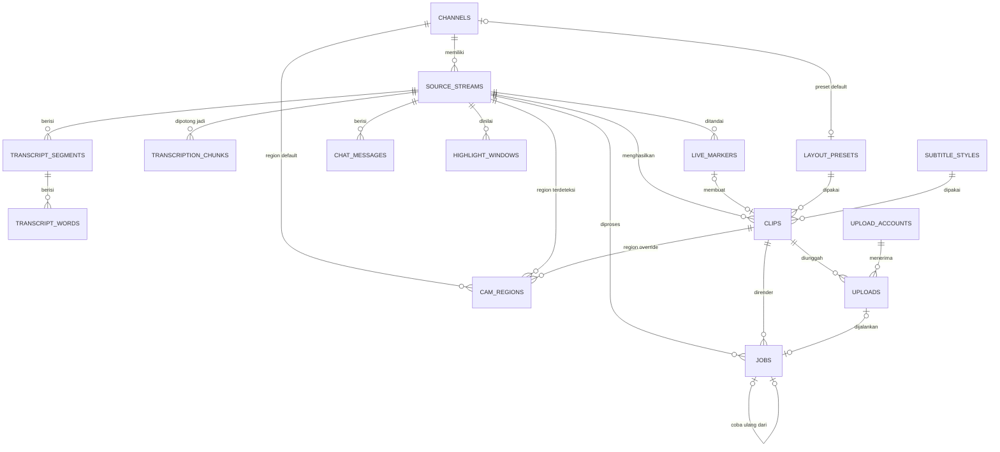

# Skema Database: Klipin
> Versi 1.2 · 2026-11-20 · Status: Draf · Dokumen terkait: 01-prd.md, 02-requirements.md, 03-user-flow.md, 04-arsitektur.md

Database: **SQLite 3.35+** (butuh `RETURNING`), mode WAL, `PRAGMA foreign_keys = ON`, `PRAGMA busy_timeout = 5000`. Dikelola dengan SQLAlchemy 2 + Alembic. File: `{KLIPIN_HOME}/klipin.db`.

Konvensi:
- PK `id INTEGER PRIMARY KEY` (rowid, autoincrement implisit). Tidak memakai UUID karena aplikasi lokal tunggal.
- Waktu kejadian (`created_at`, `updated_at`, `*_at`) disimpan sebagai `TEXT` ISO-8601 UTC (`2026-11-20T04:33:00Z`). SQLite tidak punya tipe timestamptz; aplikasi selalu menulis UTC.
- Posisi media disimpan sebagai `INTEGER` milidetik relatif awal Stream Sumber, dengan akhiran `_ms` (BR-010).
- Boolean disimpan sebagai `INTEGER` 0/1 dengan `CHECK`.
- Enum disimpan sebagai `TEXT` dengan `CHECK (... IN (...))`. Nilai sama persis dengan Kamus Istilah 01-prd.md.
- JSON disimpan sebagai `TEXT` dengan `CHECK (json_valid(...))`.
- `updated_at` diperbarui oleh aplikasi (SQLAlchemy `onupdate`).
- API key dan token OAuth **tidak** disimpan di database (ADR-007), hanya di keyring OS.

## 1. ERD


## 2. Tabel

### `channels`: Kanal
| Kolom | Tipe | Null | Default | Constraint | Keterangan |
|---|---|---|---|---|---|
| id | INTEGER | tidak | auto | PK | |
| platform | TEXT | tidak | | CHECK IN (`youtube`,`kick`,`local`) | |
| external_id | TEXT | ya | | UNIQUE(platform, external_id) | ID kanal dari yt-dlp (`channel_id`/slug Kick); null untuk Kanal buatan manual |
| name | TEXT | tidak | | CHECK length 1–200 | Nama tampil |
| default_layout_preset_id | INTEGER | ya | | FK → layout_presets.id | Diisi lewat FR-008 |
| created_at | TEXT | tidak | now UTC | | |
| updated_at | TEXT | tidak | now UTC | | |

### `source_streams`: Stream Sumber
| Kolom | Tipe | Null | Default | Constraint | Keterangan |
|---|---|---|---|---|---|
| id | INTEGER | tidak | auto | PK | Juga nama folder `streams/{id}/` |
| channel_id | INTEGER | ya | | FK → channels.id | Null untuk file lokal tanpa Kanal |
| source_type | TEXT | tidak | | CHECK IN (`vod_url`,`live_url`,`local_file`) | Jenis Sumber |
| platform | TEXT | tidak | | CHECK IN (`youtube`,`kick`,`local`) | |
| source_url | TEXT | ya | | CHECK wajib jika source_type ≠ `local_file` | URL asli |
| external_video_id | TEXT | ya | | | ID video dari platform |
| title | TEXT | tidak | | CHECK length 1–500 | |
| duration_ms | INTEGER | ya | | CHECK ≥ 0 | Null selama `recording` |
| status | TEXT | tidak | `queued` | CHECK IN (`queued`,`downloading`,`recording`,`processing`,`ready`,`failed`) | Status Stream Sumber |
| detected_language | TEXT | ya | | | Kode ISO 639-1 (`id`,`en`, …) dari transkripsi |
| has_chat | INTEGER | tidak | 0 | CHECK IN (0,1) | 1 jika Pesan Chat tersedia (BR-002) |
| suggested_layout_preset_id | INTEGER | ya | | FK → layout_presets.id | Hasil FR-006 |
| video_path | TEXT | ya | | | Relatif ke KLIPIN_HOME; null setelah "Hapus video sumber" |
| video_width | INTEGER | ya | | CHECK > 0 | |
| video_height | INTEGER | ya | | CHECK > 0 | |
| video_fps | REAL | ya | | CHECK > 0 | Metadata saja, bukan perhitungan |
| source_deleted_at | TEXT | ya | | | Waktu video sumber dihapus (FR-024) |
| live_analysis_enabled | INTEGER | tidak | 0 | CHECK IN (0,1) | FR-013 |
| live_started_at | TEXT | ya | | | Wall-clock UTC segmen pertama; untuk konversi chat live ke `_ms` |
| error_message | TEXT | ya | | | Pesan terakhir saat `failed` |
| created_at | TEXT | tidak | now UTC | | |
| updated_at | TEXT | tidak | now UTC | | |

### `jobs`: Job
| Kolom | Tipe | Null | Default | Constraint | Keterangan |
|---|---|---|---|---|---|
| id | INTEGER | tidak | auto | PK | |
| job_type | TEXT | tidak | | CHECK IN (`download`,`record_live`,`transcribe`,`detect_layout`,`score_highlights`,`render`,`upload`) | Jenis Job |
| status | TEXT | tidak | `queued` | CHECK IN (`queued`,`running`,`succeeded`,`failed`,`cancelled`) | Status Job |
| source_stream_id | INTEGER | ya | | FK → source_streams.id | Wajib untuk semua jenis kecuali `upload` (lihat CHECK) |
| clip_id | INTEGER | ya | | FK → clips.id | Wajib untuk `render` |
| purpose | TEXT | tidak | `final` | CHECK IN (`final`,`preview`) | `preview` = render pratinjau 5 detik (tidak mengubah status Klip); hanya untuk `render` |
| preview_at_ms | INTEGER | ya | | CHECK ≥ 0; wajib jika `purpose = preview` | Awal potongan pratinjau |
| upload_id | INTEGER | ya | | FK → uploads.id | Wajib untuk `upload` |
| scope_start_ms | INTEGER | ya | | CHECK ≥ 0 | Untuk `transcribe`/`score_highlights` rentang (Penanda Live / blok live); null = seluruh stream |
| scope_end_ms | INTEGER | ya | | CHECK > scope_start_ms | |
| is_heavy | INTEGER | tidak | 1 | CHECK IN (0,1) | 0 = slot ringan (ADR-002): `upload`, `transcribe` rentang Penanda Live |
| priority | INTEGER | tidak | 0 | | Lebih besar = lebih dulu |
| awaiting_confirmation | INTEGER | tidak | 0 | CHECK IN (0,1) | 1 = menunggu konfirmasi pemakaian (FR-022) |
| progress_pct | INTEGER | tidak | 0 | CHECK 0–100 | |
| stage | TEXT | ya | | | Teks tahap, mis. "Mengirim audio 7/20" |
| checkpoint | TEXT | ya | | CHECK json_valid | Data lanjutan untuk coba ulang, mis. `{"last_chunk": 6}` |
| log_tail | TEXT | ya | | | ≤ 4.000 karakter terakhir log Job |
| error_message | TEXT | ya | | | |
| retry_of_job_id | INTEGER | ya | | FK → jobs.id | Job asal saat "Coba lagi" |
| worker_heartbeat_at | TEXT | ya | | | Diperbarui tiap 10 detik saat `running` |
| started_at | TEXT | ya | | | |
| finished_at | TEXT | ya | | | |
| created_at | TEXT | tidak | now UTC | | |
| updated_at | TEXT | tidak | now UTC | | |

### `transcription_chunks`: potongan audio untuk transkripsi (checkpoint FR-005/FR-023)
| Kolom | Tipe | Null | Default | Constraint | Keterangan |
|---|---|---|---|---|---|
| id | INTEGER | tidak | auto | PK | |
| source_stream_id | INTEGER | tidak | | FK → source_streams.id | |
| chunk_index | INTEGER | tidak | | CHECK ≥ 0; UNIQUE(source_stream_id, start_ms) | Urutan tampil |
| start_ms | INTEGER | tidak | | CHECK ≥ 0 | |
| end_ms | INTEGER | tidak | | CHECK > start_ms | |
| audio_path | TEXT | ya | | | Dihapus setelah `done` dan Stream Sumber `ready` |
| status | TEXT | tidak | `pending` | CHECK IN (`pending`,`done`,`failed`) | Status internal, bukan entitas Kamus Istilah |
| provider | TEXT | ya | | | Penyedia yang mentranskripsi |
| attempts | INTEGER | tidak | 0 | CHECK ≥ 0 | |
| created_at | TEXT | tidak | now UTC | | |
| updated_at | TEXT | tidak | now UTC | | |

### `transcript_segments`: Segmen Transkrip
| Kolom | Tipe | Null | Default | Constraint | Keterangan |
|---|---|---|---|---|---|
| id | INTEGER | tidak | auto | PK | |
| source_stream_id | INTEGER | tidak | | FK → source_streams.id | |
| chunk_id | INTEGER | tidak | | FK → transcription_chunks.id | Untuk hapus & ulang per chunk |
| start_ms | INTEGER | tidak | | CHECK ≥ 0 | |
| end_ms | INTEGER | tidak | | CHECK ≥ start_ms | |
| speaker | TEXT | ya | | | Label diarization, dinormalkan `S1`, `S2`, … per Stream Sumber |
| language | TEXT | ya | | | Kode ISO 639-1 |
| text | TEXT | tidak | | | Teks asli |
| created_at | TEXT | tidak | now UTC | | |

### `transcript_words`: Kata Transkrip
| Kolom | Tipe | Null | Default | Constraint | Keterangan |
|---|---|---|---|---|---|
| id | INTEGER | tidak | auto | PK | |
| source_stream_id | INTEGER | tidak | | FK → source_streams.id | Duplikasi sengaja agar query rentang tidak perlu join |
| segment_id | INTEGER | tidak | | FK → transcript_segments.id | |
| start_ms | INTEGER | tidak | | CHECK ≥ 0 | |
| end_ms | INTEGER | tidak | | CHECK ≥ start_ms | |
| word | TEXT | tidak | | CHECK length ≥ 1 | Termasuk tanda baca yang menempel |
| confidence | REAL | ya | | CHECK 0–1 | |

### `chat_messages`: Pesan Chat
| Kolom | Tipe | Null | Default | Constraint | Keterangan |
|---|---|---|---|---|---|
| id | INTEGER | tidak | auto | PK | |
| source_stream_id | INTEGER | tidak | | FK → source_streams.id | |
| offset_ms | INTEGER | tidak | | | Relatif awal video; bisa negatif untuk pesan sebelum mulai (diabaikan saat skor) |
| author | TEXT | ya | | | Nama tampil; tidak dipakai untuk skor |
| message | TEXT | tidak | | | |
| is_reaction | INTEGER | tidak | 0 | CHECK IN (0,1) | 1 jika cocok kata reaksi (FR-010), dihitung saat impor |
| kind | TEXT | tidak | `text` | CHECK IN (`text`,`donation`,`membership`,`other`) | |

### `highlight_windows`: jendela penilaian (cache Sinyal agar "Hitung ulang skor" tidak memanggil LLM lagi)
| Kolom | Tipe | Null | Default | Constraint | Keterangan |
|---|---|---|---|---|---|
| id | INTEGER | tidak | auto | PK | |
| source_stream_id | INTEGER | tidak | | FK → source_streams.id | |
| start_ms | INTEGER | tidak | | CHECK ≥ 0; UNIQUE(source_stream_id, start_ms) | Jendela 60 detik, geser 30 detik (BR-003) |
| end_ms | INTEGER | tidak | | CHECK > start_ms | |
| audio_signal | REAL | tidak | | CHECK 0–1 | Sinyal Audio |
| chat_signal | REAL | ya | | CHECK 0–1 | Null jika chat tidak tersedia |
| preselected | INTEGER | tidak | 0 | CHECK IN (0,1) | Lolos pra-seleksi |
| llm_score | INTEGER | ya | | CHECK 0–100 | Sinyal LLM; null = belum dinilai/gagal |
| llm_category | TEXT | ya | | CHECK IN (`lucu`,`hype`,`kontroversial`,`informatif`,`emosional`,`lainnya`) | |
| llm_reason | TEXT | ya | | CHECK length ≤ 200 | |
| llm_suggested_start_ms | INTEGER | ya | | | |
| llm_suggested_end_ms | INTEGER | ya | | | |
| llm_suggested_title | TEXT | ya | | CHECK length ≤ 100 | |
| llm_status | TEXT | tidak | `not_requested` | CHECK IN (`not_requested`,`done`,`invalid`,`failed`) | |
| created_at | TEXT | tidak | now UTC | | |
| updated_at | TEXT | tidak | now UTC | | |

### `layout_presets`: Preset Layout
| Kolom | Tipe | Null | Default | Constraint | Keterangan |
|---|---|---|---|---|---|
| id | INTEGER | tidak | auto | PK | |
| code | TEXT | tidak | | CHECK IN (`gaming`,`podcast`,`irl`,`split_two`,`center_crop`,`custom`) | |
| name | TEXT | tidak | | UNIQUE | Nama tampil, mis. "Gaming (cam atas)" |
| is_builtin | INTEGER | tidak | 0 | CHECK IN (0,1) | Bawaan tidak bisa dihapus |
| params | TEXT | tidak | `{}` | CHECK json_valid | Mis. `{"cam_height_pct":35}`, `{"switch_hold_ms":1500}`, `{"max_pan_pct_per_s":5}` |
| created_at | TEXT | tidak | now UTC | | |
| updated_at | TEXT | tidak | now UTC | | |

### `cam_regions`: Region Cam
Satu tabel untuk tiga pemilik: default Kanal, hasil deteksi Stream Sumber, dan override Klip. Tepat satu kolom pemilik terisi.
| Kolom | Tipe | Null | Default | Constraint | Keterangan |
|---|---|---|---|---|---|
| id | INTEGER | tidak | auto | PK | |
| channel_id | INTEGER | ya | | FK → channels.id | Default Kanal (FR-008) |
| source_stream_id | INTEGER | ya | | FK → source_streams.id | Hasil `detect_layout` (FR-006) |
| clip_id | INTEGER | ya | | FK → clips.id | Override per Klip (FR-015) |
| role | TEXT | tidak | | CHECK IN (`cam`,`content`,`face_a`,`face_b`) | `cam`+`content` untuk gaming/custom; `face_a`/`face_b` untuk split_two |
| x | REAL | tidak | | CHECK 0–1 | Relatif lebar frame sumber |
| y | REAL | tidak | | CHECK 0–1 | |
| w | REAL | tidak | | CHECK 0.05–1 dan x+w ≤ 1 | |
| h | REAL | tidak | | CHECK 0.05–1 dan y+h ≤ 1 | |
| confidence | REAL | ya | | CHECK 0–1 | Null untuk input manual |
| created_at | TEXT | tidak | now UTC | | |
| updated_at | TEXT | tidak | now UTC | | |

### `subtitle_styles`: Gaya Subtitle
| Kolom | Tipe | Null | Default | Constraint | Keterangan |
|---|---|---|---|---|---|
| id | INTEGER | tidak | auto | PK | |
| name | TEXT | tidak | | UNIQUE, CHECK length 1–60 | |
| is_builtin | INTEGER | tidak | 0 | CHECK IN (0,1) | |
| mode | TEXT | tidak | | CHECK IN (`sentence`,`word_highlight`) | |
| font_family | TEXT | tidak | `Montserrat` | | Harus tersedia di sistem / folder font Klipin |
| font_size | INTEGER | tidak | 64 | CHECK 24–160 | Pixel pada kanvas 1080×1920 |
| primary_color | TEXT | tidak | `#FFFFFF` | CHECK pola `#RRGGBB` | |
| highlight_color | TEXT | tidak | `#FFD400` | CHECK pola `#RRGGBB` | Kata aktif (word_highlight) |
| outline_color | TEXT | tidak | `#000000` | CHECK pola `#RRGGBB` | |
| outline_width | INTEGER | tidak | 4 | CHECK 0–12 | |
| uppercase | INTEGER | tidak | 0 | CHECK IN (0,1) | |
| max_words_per_line | INTEGER | tidak | 3 | CHECK 1–8 | Untuk word_highlight |
| max_chars_per_line | INTEGER | tidak | 42 | CHECK 10–60 | Untuk sentence |
| position_pct | INTEGER | tidak | 70 | CHECK 5–95 | Posisi vertikal % dari atas |
| created_at | TEXT | tidak | now UTC | | |
| updated_at | TEXT | tidak | now UTC | | |

### `live_markers`: Penanda Live
| Kolom | Tipe | Null | Default | Constraint | Keterangan |
|---|---|---|---|---|---|
| id | INTEGER | tidak | auto | PK | |
| source_stream_id | INTEGER | tidak | | FK → source_streams.id | Harus `source_type = live_url` (dicek aplikasi) |
| kind | TEXT | tidak | | CHECK IN (`last_n_seconds`,`start_end`) | |
| start_ms | INTEGER | tidak | | CHECK ≥ 0 | |
| end_ms | INTEGER | ya | | CHECK > start_ms | Null selama "Tandai Mulai" belum diakhiri |
| created_at | TEXT | tidak | now UTC | | |

### `clips`: Klip
| Kolom | Tipe | Null | Default | Constraint | Keterangan |
|---|---|---|---|---|---|
| id | INTEGER | tidak | auto | PK | |
| source_stream_id | INTEGER | tidak | | FK → source_streams.id | |
| origin | TEXT | tidak | | CHECK IN (`auto`,`live_marker`,`manual`) | |
| live_marker_id | INTEGER | ya | | FK → live_markers.id, UNIQUE | Wajib jika origin = `live_marker` |
| status | TEXT | tidak | `candidate` | CHECK IN (`candidate`,`approved`,`rejected`,`rendering`,`rendered`,`render_failed`) | Status Klip |
| start_ms | INTEGER | tidak | | CHECK ≥ 0 | |
| end_ms | INTEGER | tidak | | CHECK > start_ms | Durasi 15–90 detik wajib saat `approved` (CHECK di bawah) |
| score | INTEGER | ya | | CHECK 0–100 | Skor Highlight; null untuk manual |
| score_audio | REAL | ya | | CHECK 0–1 | Rincian Sinyal saat skor dihitung |
| score_chat | REAL | ya | | CHECK 0–1 | |
| score_llm | INTEGER | ya | | CHECK 0–100 | |
| score_partial | INTEGER | tidak | 0 | CHECK IN (0,1) | BR-002 |
| category | TEXT | ya | | CHECK IN (`lucu`,`hype`,`kontroversial`,`informatif`,`emosional`,`lainnya`) | |
| reason | TEXT | ya | | CHECK length ≤ 200 | Alasan LLM |
| title | TEXT | ya | | CHECK length ≤ 100 | Default dari saran LLM |
| layout_preset_id | INTEGER | tidak | | FK → layout_presets.id | Awalnya = preset tersaran Stream Sumber / default Kanal |
| subtitle_style_id | INTEGER | tidak | | FK → subtitle_styles.id | |
| subtitle_language | TEXT | tidak | `source` | CHECK IN (`source`,`id`) | Bahasa Tampil |
| subtitle_overrides | TEXT | ya | | CHECK json_valid | Edit teks per kata/baris (BR-011), lihat bagian 6.3 |
| translated_lines | TEXT | ya | | CHECK json_valid | Cache terjemahan `[{start_ms,end_ms,text}]` |
| caption_drafts | TEXT | ya | | CHECK json_valid | Cache draf caption per platform (FR-027), lihat bagian 6.3 |
| output_video_path | TEXT | ya | | | Relatif KLIPIN_HOME, terisi saat `rendered` |
| output_srt_path | TEXT | ya | | | |
| rendered_at | TEXT | ya | | | |
| render_error | TEXT | ya | | | |
| created_at | TEXT | tidak | now UTC | | |
| updated_at | TEXT | tidak | now UTC | | |

### `upload_accounts`: Akun Unggah
| Kolom | Tipe | Null | Default | Constraint | Keterangan |
|---|---|---|---|---|---|
| id | INTEGER | tidak | auto | PK | |
| platform | TEXT | tidak | | CHECK IN (`youtube`,`tiktok`,`instagram`,`facebook`) | Platform Tujuan |
| external_account_id | TEXT | tidak | | UNIQUE(platform, external_account_id) | ID kanal YouTube / open_id TikTok / IG user ID / Facebook user ID |
| target_id | TEXT | ya | | | Tujuan posting jika berbeda dari akun: Facebook Page ID; IG user ID Professional |
| display_name | TEXT | tidak | | | Nama kanal/akun/Halaman yang tampil di P-07 |
| keyring_ref | TEXT | tidak | | UNIQUE | Nama entri keyring berisi token, mis. `klipin/{platform}/{external_account_id}` |
| scopes | TEXT | tidak | | | Scope yang diberikan |
| account_status | TEXT | tidak | `connected` | CHECK IN (`connected`,`needs_reauth`,`disconnected`) | `needs_reauth` saat token ditolak; `disconnected` setelah "Putuskan" (record dipertahankan untuk riwayat) |
| token_expires_at | TEXT | ya | | | Perkiraan kedaluwarsa refresh/long-lived token (jika diketahui) untuk peringatan di P-07 |
| connected_at | TEXT | tidak | now UTC | | |
| last_error | TEXT | ya | | | Mis. token dicabut |

Satu Akun Unggah `connected` per platform (index unik parsial, asumsi 01-prd.md).

### `uploads`: Unggahan
| Kolom | Tipe | Null | Default | Constraint | Keterangan |
|---|---|---|---|---|---|
| id | INTEGER | tidak | auto | PK | |
| clip_id | INTEGER | tidak | | FK → clips.id | |
| platform | TEXT | tidak | | CHECK IN (`youtube`,`tiktok`,`instagram`,`facebook`) | Platform Tujuan |
| mode | TEXT | tidak | `manual` | CHECK IN (`manual`,`auto`) | Mode Unggah |
| upload_account_id | INTEGER | ya | | FK → upload_accounts.id; wajib jika mode = `auto` | Null untuk manual |
| status | TEXT | tidak | `pending` | CHECK IN (`pending`,`uploading`,`uploaded`,`failed`); `uploading`/`failed` hanya untuk `auto` | Status Unggahan |
| title | TEXT | ya | | CHECK length 1–100; wajib jika platform = `youtube` | Judul (YouTube) |
| caption | TEXT | tidak | `''` | CHECK length ≤ 5000 | Deskripsi YouTube / caption TikTok, IG, FB; batas per platform dicek aplikasi |
| hashtags | TEXT | tidak | `[]` | CHECK json_valid | Array string berawalan `#` |
| visibility | TEXT | ya | | CHECK IN (`private`,`unlisted`,`public`,`followers`) | Hanya `auto`; nilai yang diizinkan per platform dipetakan adapter |
| resumable_session_url | TEXT | ya | | | Sesi unggah lanjutan (YouTube / platform lain yang mendukung) |
| platform_publish_id | TEXT | ya | | | ID proses publikasi asinkron (mis. publish/container ID) untuk cek status |
| attempts | INTEGER | tidak | 0 | CHECK 0–3 | |
| external_post_id | TEXT | ya | | | ID postingan di platform; wajib saat `auto` + `uploaded` |
| external_url | TEXT | ya | | | URL postingan (otomatis untuk `auto`, diisi Pengguna untuk `manual`) |
| posted_as_private | INTEGER | tidak | 0 | CHECK IN (0,1) | 1 jika platform memaksa private (aplikasi belum diaudit) |
| error_message | TEXT | ya | | | |
| uploaded_at | TEXT | ya | | | Untuk manual: waktu ditandai |
| created_at | TEXT | tidak | now UTC | | |
| updated_at | TEXT | tidak | now UTC | | |

### `settings`: Pengaturan (non-rahasia)
| Kolom | Tipe | Null | Default | Constraint | Keterangan |
|---|---|---|---|---|---|
| key | TEXT | tidak | | PK | Daftar kunci di bagian 6.2 |
| value | TEXT | tidak | | CHECK json_valid | |
| updated_at | TEXT | tidak | now UTC | | |

## 3. Relasi & Aturan Hapus
| Relasi | Kardinalitas | ON DELETE | Alasan |
|---|---|---|---|
| source_streams.channel_id → channels | N:1 | SET NULL | Hapus Kanal tidak menghapus stream |
| channels.default_layout_preset_id → layout_presets | N:1 | SET NULL | Preset kustom dihapus → Kanal kembali tanpa default |
| source_streams.suggested_layout_preset_id → layout_presets | N:1 | SET NULL | |
| jobs.source_stream_id → source_streams | N:1 | CASCADE | Hapus Stream Sumber = hapus riwayat Job-nya |
| jobs.clip_id → clips | N:1 | CASCADE | |
| jobs.upload_id → uploads | N:1 | CASCADE | |
| jobs.retry_of_job_id → jobs | N:1 | SET NULL | |
| transcription_chunks, transcript_segments, transcript_words, chat_messages, highlight_windows, live_markers, clips → source_streams | N:1 | CASCADE | Data turunan stream (FR-024 "Hapus Stream Sumber") |
| transcript_segments.chunk_id → transcription_chunks | N:1 | CASCADE | Transkripsi ulang satu chunk menghapus segmennya |
| transcript_words.segment_id → transcript_segments | N:1 | CASCADE | |
| clips.live_marker_id → live_markers | 1:1 | SET NULL | |
| clips.layout_preset_id → layout_presets | N:1 | RESTRICT | Preset yang masih dipakai Klip tidak boleh dihapus |
| clips.subtitle_style_id → subtitle_styles | N:1 | RESTRICT | Sama seperti di atas |
| cam_regions.channel_id / source_stream_id / clip_id | N:1 | CASCADE | Region ikut pemiliknya |
| uploads.clip_id → clips | N:1 | CASCADE | File render di folder output tidak dihapus (FR-024) |
| uploads.upload_account_id → upload_accounts | N:1 (opsional) | RESTRICT | Putuskan akun hanya menghapus token dan mengubah `account_status = disconnected`; record akun dipertahankan selama ada Unggahan (riwayat URL) |

Tidak ada soft delete: aplikasi pribadi tanpa kebutuhan audit; pemulihan cukup dari backup harian (NFR-010).

## 4. Index
| Tabel | Kolom | Jenis | Query/fitur yang dilayani |
|---|---|---|---|
| source_streams | (channel_id) | B-tree | FK; daftar stream per Kanal |
| source_streams | (status, created_at DESC) | B-tree | P-02 daftar stream & filter |
| channels | (default_layout_preset_id) | B-tree | FK |
| source_streams | (suggested_layout_preset_id) | B-tree | FK |
| jobs | (status, awaiting_confirmation, is_heavy, priority DESC, created_at) | B-tree | Klaim Job oleh Worker (04-arsitektur.md 3.1) |
| jobs | (source_stream_id, created_at DESC) | B-tree | FK; riwayat Job per stream |
| jobs | (clip_id) | B-tree | FK |
| jobs | (upload_id) | B-tree | FK |
| jobs | (retry_of_job_id) | B-tree | FK |
| transcription_chunks | (source_stream_id, start_ms) | UNIQUE | FK; checkpoint transkripsi |
| transcript_segments | (source_stream_id, start_ms) | B-tree | FK; jepret ke batas kalimat, subtitle per rentang |
| transcript_segments | (chunk_id) | B-tree | FK |
| transcript_words | (source_stream_id, start_ms) | B-tree | Ambil kata dalam rentang Klip |
| transcript_words | (segment_id) | B-tree | FK |
| chat_messages | (source_stream_id, offset_ms) | B-tree | FK; Sinyal Chat per jendela |
| highlight_windows | (source_stream_id, start_ms) | UNIQUE | FK; hitung ulang skor |
| highlight_windows | (source_stream_id, preselected) | B-tree | Ambil jendela untuk LLM |
| cam_regions | (channel_id) | B-tree | FK |
| cam_regions | (source_stream_id) | B-tree | FK |
| cam_regions | (clip_id) | B-tree | FK |
| live_markers | (source_stream_id, start_ms) | B-tree | FK; panel penanda P-03 |
| clips | (source_stream_id, status, score DESC) | B-tree | FK; P-04 daftar Klip urut skor |
| clips | (live_marker_id) | UNIQUE | FK |
| clips | (layout_preset_id) | B-tree | FK |
| clips | (subtitle_style_id) | B-tree | FK |
| uploads | (clip_id) | B-tree | FK |
| uploads | (upload_account_id) | B-tree | FK |
| uploads | (clip_id, platform) WHERE status IN ('pending','uploading','uploaded') | UNIQUE parsial | BR-009 (per Platform Tujuan, semua mode) |
| uploads | (status, mode) | B-tree | Badge "Menunggu ditandai" & daftar unggahan aktif |
| upload_accounts | (platform) WHERE account_status = 'connected' | UNIQUE parsial | Satu akun aktif per platform |

## 5. DDL
```sql
PRAGMA foreign_keys = ON;
PRAGMA journal_mode = WAL;

CREATE TABLE layout_presets (
  id          INTEGER PRIMARY KEY,
  code        TEXT NOT NULL CHECK (code IN ('gaming','podcast','irl','split_two','center_crop','custom')),
  name        TEXT NOT NULL UNIQUE,
  is_builtin  INTEGER NOT NULL DEFAULT 0 CHECK (is_builtin IN (0,1)),
  params      TEXT NOT NULL DEFAULT '{}' CHECK (json_valid(params)),
  created_at  TEXT NOT NULL DEFAULT (strftime('%Y-%m-%dT%H:%M:%SZ','now')),
  updated_at  TEXT NOT NULL DEFAULT (strftime('%Y-%m-%dT%H:%M:%SZ','now'))
);

CREATE TABLE channels (
  id                        INTEGER PRIMARY KEY,
  platform                  TEXT NOT NULL CHECK (platform IN ('youtube','kick','local')),
  external_id               TEXT,
  name                      TEXT NOT NULL CHECK (length(name) BETWEEN 1 AND 200),
  default_layout_preset_id  INTEGER REFERENCES layout_presets(id) ON DELETE SET NULL,
  created_at                TEXT NOT NULL DEFAULT (strftime('%Y-%m-%dT%H:%M:%SZ','now')),
  updated_at                TEXT NOT NULL DEFAULT (strftime('%Y-%m-%dT%H:%M:%SZ','now')),
  UNIQUE (platform, external_id)
);
CREATE INDEX ix_channels_default_preset ON channels(default_layout_preset_id);

CREATE TABLE source_streams (
  id                          INTEGER PRIMARY KEY,
  channel_id                  INTEGER REFERENCES channels(id) ON DELETE SET NULL,
  source_type                 TEXT NOT NULL CHECK (source_type IN ('vod_url','live_url','local_file')),
  platform                    TEXT NOT NULL CHECK (platform IN ('youtube','kick','local')),
  source_url                  TEXT,
  external_video_id           TEXT,
  title                       TEXT NOT NULL CHECK (length(title) BETWEEN 1 AND 500),
  duration_ms                 INTEGER CHECK (duration_ms >= 0),
  status                      TEXT NOT NULL DEFAULT 'queued'
                              CHECK (status IN ('queued','downloading','recording','processing','ready','failed')),
  detected_language           TEXT,
  has_chat                    INTEGER NOT NULL DEFAULT 0 CHECK (has_chat IN (0,1)),
  suggested_layout_preset_id  INTEGER REFERENCES layout_presets(id) ON DELETE SET NULL,
  video_path                  TEXT,
  video_width                 INTEGER CHECK (video_width > 0),
  video_height                INTEGER CHECK (video_height > 0),
  video_fps                   REAL CHECK (video_fps > 0),
  source_deleted_at           TEXT,
  live_analysis_enabled       INTEGER NOT NULL DEFAULT 0 CHECK (live_analysis_enabled IN (0,1)),
  live_started_at             TEXT,
  error_message               TEXT,
  created_at                  TEXT NOT NULL DEFAULT (strftime('%Y-%m-%dT%H:%M:%SZ','now')),
  updated_at                  TEXT NOT NULL DEFAULT (strftime('%Y-%m-%dT%H:%M:%SZ','now')),
  CHECK (source_type = 'local_file' OR source_url IS NOT NULL),
  CHECK ((source_type = 'local_file') = (platform = 'local'))
);
CREATE INDEX ix_streams_channel ON source_streams(channel_id);
CREATE INDEX ix_streams_status ON source_streams(status, created_at DESC);
CREATE INDEX ix_streams_suggested_preset ON source_streams(suggested_layout_preset_id);

CREATE TABLE subtitle_styles (
  id                  INTEGER PRIMARY KEY,
  name                TEXT NOT NULL UNIQUE CHECK (length(name) BETWEEN 1 AND 60),
  is_builtin          INTEGER NOT NULL DEFAULT 0 CHECK (is_builtin IN (0,1)),
  mode                TEXT NOT NULL CHECK (mode IN ('sentence','word_highlight')),
  font_family         TEXT NOT NULL DEFAULT 'Montserrat',
  font_size           INTEGER NOT NULL DEFAULT 64 CHECK (font_size BETWEEN 24 AND 160),
  primary_color       TEXT NOT NULL DEFAULT '#FFFFFF' CHECK (primary_color GLOB '#[0-9A-Fa-f][0-9A-Fa-f][0-9A-Fa-f][0-9A-Fa-f][0-9A-Fa-f][0-9A-Fa-f]'),
  highlight_color     TEXT NOT NULL DEFAULT '#FFD400' CHECK (highlight_color GLOB '#[0-9A-Fa-f][0-9A-Fa-f][0-9A-Fa-f][0-9A-Fa-f][0-9A-Fa-f][0-9A-Fa-f]'),
  outline_color       TEXT NOT NULL DEFAULT '#000000' CHECK (outline_color GLOB '#[0-9A-Fa-f][0-9A-Fa-f][0-9A-Fa-f][0-9A-Fa-f][0-9A-Fa-f][0-9A-Fa-f]'),
  outline_width       INTEGER NOT NULL DEFAULT 4 CHECK (outline_width BETWEEN 0 AND 12),
  uppercase           INTEGER NOT NULL DEFAULT 0 CHECK (uppercase IN (0,1)),
  max_words_per_line  INTEGER NOT NULL DEFAULT 3 CHECK (max_words_per_line BETWEEN 1 AND 8),
  max_chars_per_line  INTEGER NOT NULL DEFAULT 42 CHECK (max_chars_per_line BETWEEN 10 AND 60),
  position_pct        INTEGER NOT NULL DEFAULT 70 CHECK (position_pct BETWEEN 5 AND 95),
  created_at          TEXT NOT NULL DEFAULT (strftime('%Y-%m-%dT%H:%M:%SZ','now')),
  updated_at          TEXT NOT NULL DEFAULT (strftime('%Y-%m-%dT%H:%M:%SZ','now'))
);

CREATE TABLE live_markers (
  id                INTEGER PRIMARY KEY,
  source_stream_id  INTEGER NOT NULL REFERENCES source_streams(id) ON DELETE CASCADE,
  kind              TEXT NOT NULL CHECK (kind IN ('last_n_seconds','start_end')),
  start_ms          INTEGER NOT NULL CHECK (start_ms >= 0),
  end_ms            INTEGER CHECK (end_ms > start_ms),
  created_at        TEXT NOT NULL DEFAULT (strftime('%Y-%m-%dT%H:%M:%SZ','now'))
);
CREATE INDEX ix_markers_stream ON live_markers(source_stream_id, start_ms);

CREATE TABLE clips (
  id                  INTEGER PRIMARY KEY,
  source_stream_id    INTEGER NOT NULL REFERENCES source_streams(id) ON DELETE CASCADE,
  origin              TEXT NOT NULL CHECK (origin IN ('auto','live_marker','manual')),
  live_marker_id      INTEGER UNIQUE REFERENCES live_markers(id) ON DELETE SET NULL,
  status              TEXT NOT NULL DEFAULT 'candidate'
                      CHECK (status IN ('candidate','approved','rejected','rendering','rendered','render_failed')),
  start_ms            INTEGER NOT NULL CHECK (start_ms >= 0),
  end_ms              INTEGER NOT NULL CHECK (end_ms > start_ms),
  score               INTEGER CHECK (score BETWEEN 0 AND 100),
  score_audio         REAL CHECK (score_audio BETWEEN 0 AND 1),
  score_chat          REAL CHECK (score_chat BETWEEN 0 AND 1),
  score_llm           INTEGER CHECK (score_llm BETWEEN 0 AND 100),
  score_partial       INTEGER NOT NULL DEFAULT 0 CHECK (score_partial IN (0,1)),
  category            TEXT CHECK (category IN ('lucu','hype','kontroversial','informatif','emosional','lainnya')),
  reason              TEXT CHECK (length(reason) <= 200),
  title               TEXT CHECK (length(title) <= 100),
  layout_preset_id    INTEGER NOT NULL REFERENCES layout_presets(id) ON DELETE RESTRICT,
  subtitle_style_id   INTEGER NOT NULL REFERENCES subtitle_styles(id) ON DELETE RESTRICT,
  subtitle_language   TEXT NOT NULL DEFAULT 'source' CHECK (subtitle_language IN ('source','id')),
  subtitle_overrides  TEXT CHECK (subtitle_overrides IS NULL OR json_valid(subtitle_overrides)),
  translated_lines    TEXT CHECK (translated_lines IS NULL OR json_valid(translated_lines)),
  caption_drafts      TEXT CHECK (caption_drafts IS NULL OR json_valid(caption_drafts)),
  output_video_path   TEXT,
  output_srt_path     TEXT,
  rendered_at         TEXT,
  render_error        TEXT,
  created_at          TEXT NOT NULL DEFAULT (strftime('%Y-%m-%dT%H:%M:%SZ','now')),
  updated_at          TEXT NOT NULL DEFAULT (strftime('%Y-%m-%dT%H:%M:%SZ','now')),
  -- BR-004: durasi 15–90 detik wajib untuk status setelah review
  CHECK (status IN ('candidate','rejected') OR (end_ms - start_ms) BETWEEN 15000 AND 90000),
  CHECK (origin = 'live_marker' OR live_marker_id IS NULL),
  CHECK (status <> 'rendered' OR output_video_path IS NOT NULL)
);
CREATE INDEX ix_clips_stream ON clips(source_stream_id, status, score DESC);
CREATE INDEX ix_clips_preset ON clips(layout_preset_id);
CREATE INDEX ix_clips_style ON clips(subtitle_style_id);

CREATE TABLE upload_accounts (
  id                   INTEGER PRIMARY KEY,
  platform             TEXT NOT NULL CHECK (platform IN ('youtube','tiktok','instagram','facebook')),
  external_account_id  TEXT NOT NULL,
  target_id            TEXT,
  display_name         TEXT NOT NULL,
  keyring_ref          TEXT NOT NULL UNIQUE,
  scopes               TEXT NOT NULL,
  account_status       TEXT NOT NULL DEFAULT 'connected' CHECK (account_status IN ('connected','needs_reauth','disconnected')),
  token_expires_at     TEXT,
  connected_at         TEXT NOT NULL DEFAULT (strftime('%Y-%m-%dT%H:%M:%SZ','now')),
  last_error           TEXT,
  UNIQUE (platform, external_account_id),
  CHECK (platform NOT IN ('facebook','instagram') OR target_id IS NOT NULL)
);
CREATE UNIQUE INDEX ux_accounts_one_connected ON upload_accounts(platform)
  WHERE account_status = 'connected';

CREATE TABLE uploads (
  id                     INTEGER PRIMARY KEY,
  clip_id                INTEGER NOT NULL REFERENCES clips(id) ON DELETE CASCADE,
  platform               TEXT NOT NULL CHECK (platform IN ('youtube','tiktok','instagram','facebook')),
  mode                   TEXT NOT NULL DEFAULT 'manual' CHECK (mode IN ('manual','auto')),
  upload_account_id      INTEGER REFERENCES upload_accounts(id) ON DELETE RESTRICT,
  status                 TEXT NOT NULL DEFAULT 'pending' CHECK (status IN ('pending','uploading','uploaded','failed')),
  title                  TEXT CHECK (title IS NULL OR length(title) BETWEEN 1 AND 100),
  caption                TEXT NOT NULL DEFAULT '' CHECK (length(caption) <= 5000),
  hashtags               TEXT NOT NULL DEFAULT '[]' CHECK (json_valid(hashtags)),
  visibility             TEXT CHECK (visibility IN ('private','unlisted','public','followers')),
  resumable_session_url  TEXT,
  platform_publish_id    TEXT,
  attempts               INTEGER NOT NULL DEFAULT 0 CHECK (attempts BETWEEN 0 AND 3),
  external_post_id       TEXT,
  external_url           TEXT,
  posted_as_private      INTEGER NOT NULL DEFAULT 0 CHECK (posted_as_private IN (0,1)),
  error_message          TEXT,
  uploaded_at            TEXT,
  created_at             TEXT NOT NULL DEFAULT (strftime('%Y-%m-%dT%H:%M:%SZ','now')),
  updated_at             TEXT NOT NULL DEFAULT (strftime('%Y-%m-%dT%H:%M:%SZ','now')),
  CHECK (mode = 'manual' OR upload_account_id IS NOT NULL),                 -- BR-013
  CHECK (mode = 'auto' OR status IN ('pending','uploaded')),                -- manual tidak punya uploading/failed
  CHECK (mode = 'auto' OR visibility IS NULL),
  CHECK (platform <> 'youtube' OR title IS NOT NULL),
  CHECK (mode = 'manual' OR status <> 'uploaded' OR external_post_id IS NOT NULL)
);
CREATE INDEX ix_uploads_clip ON uploads(clip_id);
CREATE INDEX ix_uploads_account ON uploads(upload_account_id);
CREATE INDEX ix_uploads_status_mode ON uploads(status, mode);
CREATE UNIQUE INDEX ux_uploads_active ON uploads(clip_id, platform)
  WHERE status IN ('pending','uploading','uploaded');           -- BR-009

CREATE TABLE jobs (
  id                     INTEGER PRIMARY KEY,
  job_type               TEXT NOT NULL CHECK (job_type IN ('download','record_live','transcribe','detect_layout','score_highlights','render','upload')),
  status                 TEXT NOT NULL DEFAULT 'queued' CHECK (status IN ('queued','running','succeeded','failed','cancelled')),
  source_stream_id       INTEGER REFERENCES source_streams(id) ON DELETE CASCADE,
  clip_id                INTEGER REFERENCES clips(id) ON DELETE CASCADE,
  upload_id              INTEGER REFERENCES uploads(id) ON DELETE CASCADE,
  purpose                TEXT NOT NULL DEFAULT 'final' CHECK (purpose IN ('final','preview')),
  preview_at_ms          INTEGER CHECK (preview_at_ms >= 0),
  scope_start_ms         INTEGER CHECK (scope_start_ms >= 0),
  scope_end_ms           INTEGER CHECK (scope_end_ms > scope_start_ms),
  is_heavy               INTEGER NOT NULL DEFAULT 1 CHECK (is_heavy IN (0,1)),
  priority               INTEGER NOT NULL DEFAULT 0,
  awaiting_confirmation  INTEGER NOT NULL DEFAULT 0 CHECK (awaiting_confirmation IN (0,1)),
  progress_pct           INTEGER NOT NULL DEFAULT 0 CHECK (progress_pct BETWEEN 0 AND 100),
  stage                  TEXT,
  checkpoint             TEXT CHECK (checkpoint IS NULL OR json_valid(checkpoint)),
  log_tail               TEXT CHECK (length(log_tail) <= 4000),
  error_message          TEXT,
  retry_of_job_id        INTEGER REFERENCES jobs(id) ON DELETE SET NULL,
  worker_heartbeat_at    TEXT,
  started_at             TEXT,
  finished_at            TEXT,
  created_at             TEXT NOT NULL DEFAULT (strftime('%Y-%m-%dT%H:%M:%SZ','now')),
  updated_at             TEXT NOT NULL DEFAULT (strftime('%Y-%m-%dT%H:%M:%SZ','now')),
  CHECK (job_type = 'upload' OR source_stream_id IS NOT NULL),
  CHECK (job_type <> 'render' OR clip_id IS NOT NULL),
  CHECK (job_type <> 'upload' OR upload_id IS NOT NULL),
  CHECK ((scope_start_ms IS NULL) = (scope_end_ms IS NULL)),
  CHECK (purpose = 'final' OR (job_type = 'render' AND preview_at_ms IS NOT NULL))
);
CREATE INDEX ix_jobs_claim ON jobs(status, awaiting_confirmation, is_heavy, priority DESC, created_at);
CREATE INDEX ix_jobs_stream ON jobs(source_stream_id, created_at DESC);
CREATE INDEX ix_jobs_clip ON jobs(clip_id);
CREATE INDEX ix_jobs_upload ON jobs(upload_id);
CREATE INDEX ix_jobs_retry ON jobs(retry_of_job_id);

CREATE TABLE transcription_chunks (
  id                INTEGER PRIMARY KEY,
  source_stream_id  INTEGER NOT NULL REFERENCES source_streams(id) ON DELETE CASCADE,
  chunk_index       INTEGER NOT NULL CHECK (chunk_index >= 0),
  start_ms          INTEGER NOT NULL CHECK (start_ms >= 0),
  end_ms            INTEGER NOT NULL CHECK (end_ms > start_ms),
  audio_path        TEXT,
  status            TEXT NOT NULL DEFAULT 'pending' CHECK (status IN ('pending','done','failed')),
  provider          TEXT,
  attempts          INTEGER NOT NULL DEFAULT 0 CHECK (attempts >= 0),
  created_at        TEXT NOT NULL DEFAULT (strftime('%Y-%m-%dT%H:%M:%SZ','now')),
  updated_at        TEXT NOT NULL DEFAULT (strftime('%Y-%m-%dT%H:%M:%SZ','now')),
  UNIQUE (source_stream_id, start_ms)
);

CREATE TABLE transcript_segments (
  id                INTEGER PRIMARY KEY,
  source_stream_id  INTEGER NOT NULL REFERENCES source_streams(id) ON DELETE CASCADE,
  chunk_id          INTEGER NOT NULL REFERENCES transcription_chunks(id) ON DELETE CASCADE,
  start_ms          INTEGER NOT NULL CHECK (start_ms >= 0),
  end_ms            INTEGER NOT NULL CHECK (end_ms >= start_ms),
  speaker           TEXT,
  language          TEXT,
  text              TEXT NOT NULL,
  created_at        TEXT NOT NULL DEFAULT (strftime('%Y-%m-%dT%H:%M:%SZ','now'))
);
CREATE INDEX ix_segments_stream ON transcript_segments(source_stream_id, start_ms);
CREATE INDEX ix_segments_chunk ON transcript_segments(chunk_id);

CREATE TABLE transcript_words (
  id                INTEGER PRIMARY KEY,
  source_stream_id  INTEGER NOT NULL REFERENCES source_streams(id) ON DELETE CASCADE,
  segment_id        INTEGER NOT NULL REFERENCES transcript_segments(id) ON DELETE CASCADE,
  start_ms          INTEGER NOT NULL CHECK (start_ms >= 0),
  end_ms            INTEGER NOT NULL CHECK (end_ms >= start_ms),
  word              TEXT NOT NULL CHECK (length(word) >= 1),
  confidence        REAL CHECK (confidence BETWEEN 0 AND 1)
);
CREATE INDEX ix_words_stream ON transcript_words(source_stream_id, start_ms);
CREATE INDEX ix_words_segment ON transcript_words(segment_id);

CREATE TABLE chat_messages (
  id                INTEGER PRIMARY KEY,
  source_stream_id  INTEGER NOT NULL REFERENCES source_streams(id) ON DELETE CASCADE,
  offset_ms         INTEGER NOT NULL,
  author            TEXT,
  message           TEXT NOT NULL,
  is_reaction       INTEGER NOT NULL DEFAULT 0 CHECK (is_reaction IN (0,1)),
  kind              TEXT NOT NULL DEFAULT 'text' CHECK (kind IN ('text','donation','membership','other'))
);
CREATE INDEX ix_chat_stream ON chat_messages(source_stream_id, offset_ms);

CREATE TABLE highlight_windows (
  id                      INTEGER PRIMARY KEY,
  source_stream_id        INTEGER NOT NULL REFERENCES source_streams(id) ON DELETE CASCADE,
  start_ms                INTEGER NOT NULL CHECK (start_ms >= 0),
  end_ms                  INTEGER NOT NULL CHECK (end_ms > start_ms),
  audio_signal            REAL NOT NULL CHECK (audio_signal BETWEEN 0 AND 1),
  chat_signal             REAL CHECK (chat_signal BETWEEN 0 AND 1),
  preselected             INTEGER NOT NULL DEFAULT 0 CHECK (preselected IN (0,1)),
  llm_score               INTEGER CHECK (llm_score BETWEEN 0 AND 100),
  llm_category            TEXT CHECK (llm_category IN ('lucu','hype','kontroversial','informatif','emosional','lainnya')),
  llm_reason              TEXT CHECK (length(llm_reason) <= 200),
  llm_suggested_start_ms  INTEGER,
  llm_suggested_end_ms    INTEGER,
  llm_suggested_title     TEXT CHECK (length(llm_suggested_title) <= 100),
  llm_status              TEXT NOT NULL DEFAULT 'not_requested' CHECK (llm_status IN ('not_requested','done','invalid','failed')),
  created_at              TEXT NOT NULL DEFAULT (strftime('%Y-%m-%dT%H:%M:%SZ','now')),
  updated_at              TEXT NOT NULL DEFAULT (strftime('%Y-%m-%dT%H:%M:%SZ','now')),
  UNIQUE (source_stream_id, start_ms)
);
CREATE INDEX ix_windows_preselected ON highlight_windows(source_stream_id, preselected);

CREATE TABLE cam_regions (
  id                INTEGER PRIMARY KEY,
  channel_id        INTEGER REFERENCES channels(id) ON DELETE CASCADE,
  source_stream_id  INTEGER REFERENCES source_streams(id) ON DELETE CASCADE,
  clip_id           INTEGER REFERENCES clips(id) ON DELETE CASCADE,
  role              TEXT NOT NULL CHECK (role IN ('cam','content','face_a','face_b')),
  x                 REAL NOT NULL CHECK (x BETWEEN 0 AND 1),
  y                 REAL NOT NULL CHECK (y BETWEEN 0 AND 1),
  w                 REAL NOT NULL CHECK (w BETWEEN 0.05 AND 1),
  h                 REAL NOT NULL CHECK (h BETWEEN 0.05 AND 1),
  confidence        REAL CHECK (confidence BETWEEN 0 AND 1),
  created_at        TEXT NOT NULL DEFAULT (strftime('%Y-%m-%dT%H:%M:%SZ','now')),
  updated_at        TEXT NOT NULL DEFAULT (strftime('%Y-%m-%dT%H:%M:%SZ','now')),
  CHECK (x + w <= 1.0001 AND y + h <= 1.0001),
  CHECK ((channel_id IS NOT NULL) + (source_stream_id IS NOT NULL) + (clip_id IS NOT NULL) = 1)
);
CREATE INDEX ix_regions_channel ON cam_regions(channel_id);
CREATE INDEX ix_regions_stream ON cam_regions(source_stream_id);
CREATE INDEX ix_regions_clip ON cam_regions(clip_id);
-- satu region per role per pemilik
CREATE UNIQUE INDEX ux_regions_channel_role ON cam_regions(channel_id, role) WHERE channel_id IS NOT NULL;
CREATE UNIQUE INDEX ux_regions_stream_role  ON cam_regions(source_stream_id, role) WHERE source_stream_id IS NOT NULL;
CREATE UNIQUE INDEX ux_regions_clip_role    ON cam_regions(clip_id, role) WHERE clip_id IS NOT NULL;

CREATE TABLE settings (
  key         TEXT PRIMARY KEY,
  value       TEXT NOT NULL CHECK (json_valid(value)),
  updated_at  TEXT NOT NULL DEFAULT (strftime('%Y-%m-%dT%H:%M:%SZ','now'))
);
```

Catatan: CHECK ke-2 di `clips` hanya melarang `live_marker_id` terisi pada Klip non-`live_marker`. Kewajiban "Klip `live_marker` punya `live_marker_id` saat dibuat" dijaga di aplikasi, karena kolom itu boleh menjadi NULL kemudian (`ON DELETE SET NULL`).

## 6. Enum, Status & Data Awal (seed)

### 6.1 Enum
| Enum | Nilai | Dipakai di |
|---|---|---|
| Status Stream Sumber | `queued`, `downloading`, `recording`, `processing`, `ready`, `failed` | source_streams.status |
| Jenis Sumber | `vod_url`, `live_url`, `local_file` | source_streams.source_type |
| Platform | `youtube`, `kick`, `local` | channels, source_streams |
| Jenis Job | `download`, `record_live`, `transcribe`, `detect_layout`, `score_highlights`, `render`, `upload` | jobs.job_type |
| Status Job | `queued`, `running`, `succeeded`, `failed`, `cancelled` | jobs.status |
| Status Klip | `candidate`, `approved`, `rejected`, `rendering`, `rendered`, `render_failed` | clips.status |
| Asal Klip | `auto`, `live_marker`, `manual` | clips.origin |
| Kategori highlight | `lucu`, `hype`, `kontroversial`, `informatif`, `emosional`, `lainnya` | clips.category, highlight_windows.llm_category |
| Bahasa Tampil | `source`, `id` | clips.subtitle_language |
| Mode subtitle | `sentence`, `word_highlight` | subtitle_styles.mode |
| Kode Preset Layout | `gaming`, `podcast`, `irl`, `split_two`, `center_crop`, `custom` | layout_presets.code |
| Peran Region Cam | `cam`, `content`, `face_a`, `face_b` | cam_regions.role |
| Status Unggahan | `pending`, `uploading`, `uploaded`, `failed` (manual hanya `pending`, `uploaded`) | uploads.status |
| Platform Tujuan | `youtube`, `tiktok`, `instagram`, `facebook` | upload_accounts.platform, uploads.platform |
| Mode Unggah | `manual`, `auto` | uploads.mode |
| Status Akun Unggah | `connected`, `needs_reauth`, `disconnected` | upload_accounts.account_status |
| Visibilitas | `private`, `unlisted`, `public`, `followers` (dipetakan adapter ke nilai tiap platform) | uploads.visibility |

### 6.2 Seed
```sql
INSERT INTO layout_presets (code, name, is_builtin, params) VALUES
 ('gaming',      'Gaming (cam atas)',       1, '{"cam_height_pct":35}'),
 ('podcast',     'Podcast (ikuti pembicara)',1, '{"switch_hold_ms":1500}'),
 ('irl',         'IRL (ikuti wajah)',       1, '{"max_pan_pct_per_s":5}'),
 ('split_two',   'Dua Orang (atas-bawah)',  1, '{"split_pct":50}'),
 ('center_crop', 'Crop Tengah',             1, '{}'),
 ('custom',      'Kustom',                  1, '{}');

INSERT INTO subtitle_styles (name, is_builtin, mode, font_size, uppercase, max_words_per_line, position_pct) VALUES
 ('Sederhana',      1, 'sentence',       56, 0, 3, 75),
 ('Highlight Kata', 1, 'word_highlight', 68, 0, 3, 70),
 ('Besar Tengah',   1, 'word_highlight', 96, 1, 2, 55);

INSERT INTO settings (key, value) VALUES
 ('score_weights',            '{"audio":0.30,"chat":0.20,"llm":0.50}'),   -- BR-001
 ('score_min_threshold',      '40'),                                      -- BR-006
 ('chat_delay_ms',            '8000'),                                    -- FR-010
 ('chat_reaction_words',      '["wkwk","wkwkwk","awokawok","anjir","anjay","gg","kekw","lol","lmao","pog","omegalul","😂","🤣"]'),
 ('live_segment_seconds',     '10'),
 ('live_block_minutes',       '5'),                                       -- FR-013
 ('live_last_n_default_s',    '60'),                                      -- FR-004
 ('max_heavy_jobs',           '1'),
 ('confirm_usage_over_min',   '30'),                                      -- FR-022
 ('max_audio_minutes_per_job','600'),
 ('transcriber_provider',     '"deepgram"'),
 ('llm_provider',             '"anthropic"'),
 ('llm_models',               '{"judge_highlight":null,"translate_lines":null,"write_captions":null}'),  -- diisi nama model saat setup (07-integrasi.md INT-05)
 ('kick_live_chat_enabled',   'false'),                                   -- INT-03 eksperimental
 ('default_subtitle_style',   '"Highlight Kata"'),
 ('output_dir',               '"output"'),
 ('download_max_height',      '1080'),
 ('upload_default_mode',      '"manual"'),                                -- F-16
 ('caption_templates',        '{"youtube":"","tiktok":"","instagram":"","facebook":""}'),  -- FR-027, teks tetap di akhir caption
 ('upload_platforms_enabled', '["youtube","tiktok","instagram","facebook"]'),
 ('manual_upload_urls',       '{"youtube":"https://studio.youtube.com","tiktok":"https://www.tiktok.com/upload","instagram":"https://www.instagram.com","facebook":"https://business.facebook.com"}');  -- INT-13
```
`transcriber_provider = deepgram` dan `llm_provider = anthropic` adalah default dari 07-integrasi.md; `transcriber_provider` bisa berubah setelah uji A/B (09-testing.md bagian 4.2). `llm_models` sengaja `null` agar nama model dipilih saat setup, bukan di-hardcode.

### 6.3 Format JSON
`clips.subtitle_overrides`, edit teks tanpa mengubah Kata Transkrip (BR-011):
```json
{
  "words": { "128834": "gue", "128840": "" },
  "line_breaks_after_word_ids": [128836, 128842]
}
```
- Kunci `words` = `transcript_words.id`; nilai string pengganti; string kosong = kata disembunyikan.
- Untuk Bahasa Tampil `id`, edit dilakukan pada `translated_lines`.

`clips.translated_lines`:
```json
[{ "start_ms": 3601200, "end_ms": 3603900, "text": "Gila, dia beneran lompat!" }]
```

`clips.caption_drafts` (FR-027; draf LLM + hasil edit Pengguna sebelum Unggahan dibuat):
```json
{
  "youtube":   { "title": "Jumpscare paling brutal", "caption": "Momen kaget di stream horor…", "hashtags": ["#shorts", "#horor"], "edited": false },
  "tiktok":    { "caption": "POV: jumpscare jam 3 pagi 😭", "hashtags": ["#fyp", "#horor", "#gaming"], "edited": true },
  "generated_at": "2026-11-20T06:10:00Z"
}
```
Saat Unggahan dibuat, nilai draf platform disalin ke `uploads.title/caption/hashtags`.

`jobs.checkpoint` (contoh per Jenis Job):
```json
{ "transcribe": { "chunks_done": [0,1,2,3,4,5] },
  "score_highlights": { "stage": "llm", "windows_done": 84 },
  "record_live": { "last_segment": 431, "gaps_ms": [[1203000,1241000]] } }
```

## 7. Data Sensitif, Retensi & Backup
| Kolom | Klasifikasi | Perlakuan (enkripsi/masking/akses terbatas) | Retensi |
|---|---|---|---|
| API key transkripsi & LLM | Rahasia | Tidak di DB; keyring OS (ADR-007); dimasking di UI & log | Sampai dihapus Pengguna |
| Token OAuth Google, TikTok, Meta | Rahasia | Tidak di DB; hanya `upload_accounts.keyring_ref` | Sampai "Putuskan" |
| Client secret aplikasi developer TikTok/Meta/Google | Rahasia | Tidak di DB; env/keyring (04-arsitektur.md) | Sampai diganti Pengguna |
| `uploads.external_url` manual | Umum | Diisi Pengguna; divalidasi domain | Ikut Klip |
| `chat_messages.author` | Data pribadi umum (nama tampil penonton) | Tidak dipakai untuk skor, tidak ditampilkan di UI kecuali rincian chat, tidak dikirim ke LLM | Ikut Stream Sumber |
| `transcript_*`, `chat_messages.message` | Konten pihak ketiga | Disimpan lokal; potongan transkrip dikirim ke API LLM/transkripsi (07-integrasi.md) | Ikut Stream Sumber |
| `uploads.resumable_session_url` | Semi-rahasia (URL sesi unggah) | Tidak dicatat di log; dikosongkan setelah `uploaded`/`failed` | Sampai unggah selesai |
| File video, audio, segmen | Konten pihak ketiga | Folder kerja lokal | Audio chunk & frame dihapus setelah `ready`; segmen live dihapus setelah digabung (NFR-011); video sumber sampai dihapus Pengguna (FR-024) |

Backup: SQLite online backup harian ke `backups/klipin-YYYYMMDD.db`, simpan 7 terakhir (NFR-010); backup juga dibuat sebelum setiap migrasi Alembic. File video tidak dicadangkan.

## Asumsi & Pertanyaan Terbuka
- [ASUMSI] SQLite bawaan Python 3.11 di Windows/macOS sudah ≥ 3.35 dengan JSON1 (diperiksa `klipin doctor`).
- [ASUMSI] ±70.000 baris `transcript_words` per jam audio; stream 8 jam ±560.000 baris masih aman di SQLite.
- [ASUMSI] Nama tampil penonton (`author`) disimpan untuk keperluan tampilan rincian chat saja; bisa dihapus dari skema jika tidak diperlukan.
- [ASUMSI] Font bawaan (Montserrat) dibundel di folder `fonts/` Klipin agar render konsisten di semua OS; lisensi font perlu dicek.
- [TANYA] Apakah perlu menyimpan riwayat versi edit Klip (undo antar sesi)? Saat ini hanya keadaan terakhir. (Pengguna)

## Riwayat Perubahan
| Versi | Tanggal | Perubahan |
|---|---|---|
| 1.0 | 2026-11-20 | Draf awal |
| 1.2 | 2026-11-20 | Hasil CEK #1, #7, #9: `jobs.purpose` + `preview_at_ms` untuk render pratinjau; seed `llm_models`, `kick_live_chat_enabled`; catatan default penyedia |
| 1.1 | 2026-11-20 | Menyesuaikan unggah multi-platform & Mode Unggah (01-prd.md v1.1): `upload_accounts` multi-platform (+`target_id`, `account_status`, `token_expires_at`, satu akun aktif per platform); `uploads` +`platform`, `mode`, `caption`, `hashtags`, `platform_publish_id`, `posted_as_private`, `external_post_id`, akun opsional untuk manual; BR-009 per platform; `clips.caption_drafts`; enum & seed baru (termasuk `manual_upload_urls` untuk INT-13) |
