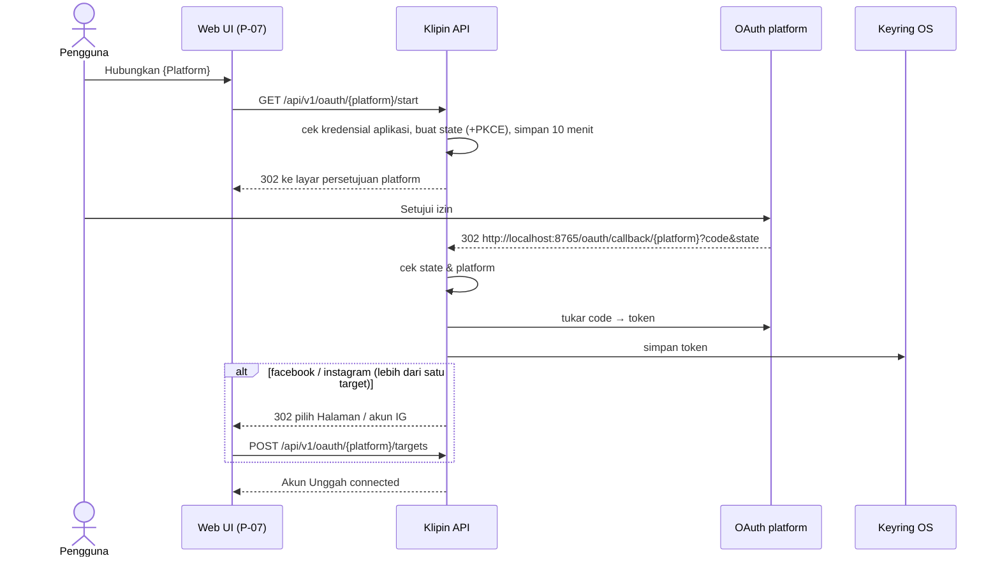

# Integrasi Pihak Ketiga: Klipin
> Versi 2.1 · 2026-11-21 · Status: Draf · Dokumen terkait: 01-prd.md, 02-requirements.md, 04-arsitektur.md, 05-database.md, 06-api.md

Fakta tentang layanan pihak ketiga di dokumen ini dicek pada 2026-11-20 dan **bisa berubah**. Harga tidak ditulis; cek di situs penyedia. Setiap integrasi dibungkus adapter (ADR-003) agar mudah diganti.

## 1. Daftar Integrasi
| Integrasi | Penyedia | Tujuan | FR | Wajib/Opsional |
|---|---|---|---|---|
| INT-01 Pengambil media | yt-dlp (open source) → YouTube, Kick | Metadata, unduh VOD, rekam live HLS | FR-001, FR-003 | Wajib |
| INT-02 Chat replay YouTube | yt-dlp (`live_chat`) | Pesan Chat untuk Sinyal Chat | FR-010 | Opsional (skor tetap jalan tanpa chat) |
| INT-03 Chat Kick | Kick (tidak resmi untuk chat lampau) | Pesan Chat Kick | FR-010 | Opsional, eksperimental |
| INT-04 Transkripsi | **Default: Deepgram** (Nova-3); alternatif: AssemblyAI | Kata + timestamp + pembicara + bahasa | FR-005, FR-004 | Wajib |
| INT-05 LLM | **Default: Anthropic Claude API**; adapter terbuka untuk penyedia lain | Sinyal LLM, saran judul, terjemahan EN→ID | FR-011, FR-016 | Wajib untuk Sinyal LLM & terjemahan |
| INT-06 OAuth 2.0 per platform | Google, TikTok, Meta | Izin posting ke akun Pengguna | FR-019 | Opsional (hanya mode `auto`) |
| INT-07 Unggah otomatis YouTube | YouTube Data API v3 (`videos.insert`) | Unggah Klip | FR-020 | Opsional (F-11, Could) |
| INT-10 Unggah otomatis TikTok | TikTok Content Posting API (Direct Post) | Unggah Klip | FR-020 | Opsional (F-12, Could) |
| INT-11 Unggah otomatis Instagram | Instagram Graph API (Reels) | Unggah Klip | FR-020 | Opsional (F-12, Could) |
| INT-12 Unggah otomatis Facebook | Facebook Pages Reels Publishing API | Unggah Klip ke Halaman | FR-020 | Opsional (F-12, Could) |
| INT-13 Paket Unggah manual | — (tanpa API) | Siapkan file + caption, buka halaman upload resmi | FR-025, FR-026 | Wajib (default) |
| INT-08 FFmpeg/FFprobe | Biner lokal | Ekstrak audio, loudness, frame, render | FR-005, FR-009, FR-018 | Wajib (lokal, bukan layanan jaringan) |
| INT-09 MediaPipe | Library lokal | Deteksi wajah | FR-006 | Wajib (lokal) |

INT-08 dan INT-09 tidak memakai jaringan, jadi detailnya ada di 04-arsitektur.md. Dokumen ini fokus pada INT-01 sampai INT-07 dan INT-10 sampai INT-13.

## 2. Detail per Integrasi

### INT-01 Pengambil media: yt-dlp → YouTube & Kick
- **Alur:**
  1. `inspect`: `yt_dlp.YoutubeDL({"skip_download": True}).extract_info(url)` → judul, `channel_id`/`uploader_id`, `duration`, `is_live`/`live_status`, daftar subtitle (adakah `live_chat`), perkiraan ukuran.
  2. `download` (VOD): format `bv*[height<=1080]+ba/b[height<=1080]`, merge ke MP4 (`--merge-output-format mp4`), `--continue` agar unduhan bisa dilanjutkan, progres lewat `progress_hooks` → `jobs.progress_pct`.
  3. `record_live`: yt-dlp mengambil URL manifest HLS (`-g` / `extract_info` format `url`), lalu FFmpeg merekam: `ffmpeg -i {m3u8} -c copy -f segment -segment_time 10 -reset_timestamps 1 segments/%06d.ts`. Manifest diperbarui ulang jika URL kedaluwarsa (token HLS Kick/YouTube punya masa berlaku).
  4. Setelah berhenti: `ffmpeg -f concat -safe 0 -i list.txt -c copy source.mp4`.
- **Data yang dikirim/diterima:** URL video; menerima file video & metadata. Tidak ada kredensial.
- **Kredensial:** tidak ada. Opsi cookies browser (`--cookies-from-browser`) **tidak** diaktifkan secara default; tidak dipakai untuk VOD khusus subscriber.
- **Kegagalan & retry:** error jaringan → yt-dlp `retries=10`, `fragment_retries=10`. Error ekstraksi (situs berubah) → Job `failed` dengan saran "Perbarui yt-dlp". Kick diketahui pernah mengembalikan 403 pada VOD tertentu, misalnya VOD khusus subscriber. Live putus < 60 detik → ambil ulang manifest maks. 6× (tiap 10 detik); ≥ 60 detik → rekaman diakhiri.
- **Idempotensi:** satu Stream Sumber per `(platform, external_video_id)` yang belum `failed` (06-api.md `POST /streams`). File unduhan parsial dilanjutkan, bukan dibuat ulang.
- **Biaya & kuota:** gratis (open source). Risiko pembatasan dari platform jika terlalu sering; Klipin hanya menjalankan 1 unduhan sekaligus.
- **Fallback:** impor file lokal (FR-002) jika pengguna mengunduh video dengan cara lain yang sah.
- **Catatan ToS:** mengunduh konten dari YouTube/Kick dapat dibatasi oleh ketentuan layanan masing-masing platform. Klipin diasumsikan dipakai untuk stream milik Pengguna atau yang sudah diizinkan (01-prd.md bagian 9). Ini bukan nasihat hukum.

### INT-02 Chat replay YouTube (yt-dlp `live_chat`)
- **Alur:** pada `download` VOD, jika `inspect` menemukan subtitle `live_chat`, jalankan `writesubtitles=True, subtitleslangs=["live_chat"]` → file JSON-lines → parser mengambil `videoOffsetTimeMsec`, author, teks, jenis (super chat → `donation`, membership → `membership`) → `chat_messages`.
- **Saat live:** yt-dlp bisa mengambil live chat yang sedang berjalan, tetapi ada laporan bahwa yang didapat adalah mode "Top Chat" (pesan tersaring), bukan semua pesan. Untuk FR-013 (analisis live) ini dianggap cukup sebagai sinyal kasar; setelah stream selesai, chat replay VOD lengkap dapat diambil ulang jika VOD tersedia.
- **Kredensial:** tidak ada.
- **Kegagalan & retry:** chat gagal diunduh → `has_chat = 0`, Job `download` tetap `succeeded` (chat opsional); dicatat di log.
- **Idempotensi:** impor chat menghapus `chat_messages` lama milik Stream Sumber dulu (dalam satu transaksi).
- **Biaya & kuota:** gratis.
- **Fallback:** BR-002 (bobot chat dibagi ke audio & LLM).

### INT-03 Chat Kick (eksperimental)
- **Kondisi saat ini:** Kick tidak menyediakan REST API terdokumentasi untuk chat lampau/VOD. Website Kick menampilkan chat live lewat WebSocket Pusher publik.
- **Rencana MVP:**
  - **VOD Kick:** tidak ada chat → `has_chat = 0` (BR-002).
  - **Live Kick (FR-003):** adapter eksperimental `KickLiveChatListener` berlangganan WebSocket chat publik kanal selama `record_live` berjalan, menyimpan pesan dengan `offset_ms = waktu_terima − live_started_at`. Dimatikan secara default (Pengaturan "Ambil chat live Kick (eksperimental)").
- **Kegagalan:** koneksi gagal/protokol berubah → listener berhenti, rekaman video tetap berjalan, `has_chat` sesuai data yang sempat masuk.
- **Risiko:** endpoint tidak resmi bisa berubah tanpa pemberitahuan dan mungkin tidak sesuai ketentuan Kick. Perlu dicek sebelum diaktifkan.
- **Fallback:** BR-002.

### INT-04 Transkripsi: Deepgram (default) / AssemblyAI (alternatif)

**Alasan default Deepgram:**
- Mendukung Bahasa Indonesia (`language=id`) di keluarga model Nova, termasuk Nova-3, beserta diarization.
- Endpoint pre-recorded menerima audio langsung dalam satu request sinkron. Ini cocok dengan desain potongan + checkpoint (`transcription_chunks`) tanpa perlu polling.

**Alternatif AssemblyAI:** model Universal-2 mendukung 99 bahasa, deteksi bahasa otomatis, dan diarization untuk sebagian besar bahasa tersebut. Alurnya asinkron (unggah → buat transkrip → polling), jadi adapternya sedikit lebih kompleks. AssemblyAI cocok sebagai cadangan atau jika kualitasnya lebih baik pada uji 09-testing.md.

Pilihan final ditentukan dengan uji A/B pada 3 sampel stream (Indo gaming, Indo podcast, Inggris) di 09-testing.md. Adapter memungkinkan ganti penyedia di Pengaturan.

- **Alur (Deepgram):**
  1. FFmpeg: ekstrak audio mono 16 kHz, Opus/FLAC, lalu potong per **10 menit** dengan tumpang tindih 2 detik → `transcription_chunks`.
  2. **Deteksi bahasa:** chunk pertama yang tidak hening dikirim dengan opsi deteksi bahasa penyedia. Hasilnya (`id`/`en`/lainnya) disimpan ke `source_streams.detected_language` dan dipakai sebagai `language` eksplisit untuk chunk berikutnya agar konsisten. Jika bukan `id`/`en` → tetap diproses dengan bahasa itu; terjemahan hanya ke `id` (FR-016).
  3. Per chunk: `POST https://api.deepgram.com/v1/listen?model=nova-3&language={lang}&diarize_model=latest&punctuate=true&smart_format=true&utterances=true` dengan body audio FLAC (`Content-Type: audio/flac`). Chunk pertama memakai `detect_language=true` sebagai ganti `language`; hasilnya dibaca dari `results.channels[0].detected_language`. Parameter `diarize` sudah deprecated di dokumentasi Deepgram (dicek 2026-11-21) dan tidak boleh dikirim bersama `diarize_model`.
  4. Normalisasi respons → kata (`word`/`punctuated_word`, `start`, `end`, `confidence`, `speaker`) dan utterance → `transcript_segments` + `transcript_words`. Waktu ditambah `chunk.start_ms`.
  5. **Penjahitan tumpang tindih:** kata di 2 detik tumpang tindih diambil dari chunk berikutnya jika `start_ms ≥ chunk_boundary`, dari chunk sebelumnya jika tidak (hindari kata ganda).
  6. **Label pembicara:** diarization per chunk menghasilkan label lokal. Label dinormalkan ke `S1`, `S2`, … per Stream Sumber dengan mencocokkan pembicara di zona tumpang tindih. Jika tidak cocok, label dibiarkan per chunk dan preset `podcast` mengandalkan deteksi wajah aktif (keterbatasan dicatat).
- **Data yang dikirim:** audio Stream Sumber (konten pihak ketiga). Tidak ada data pribadi Pengguna.
- **Kredensial:** `TRANSCRIBER_API_KEY` (keyring `klipin/transcriber_api_key`). Header `Authorization: Token {key}` (Deepgram) / `Authorization: {key}` (AssemblyAI).
- **Kegagalan & retry:** timeout 120 detik per chunk; 429/5xx/timeout → coba ulang 3× (backoff 2/4/8 detik + jitter). 400 (audio rusak) → chunk ditandai `failed`, Job `failed`. 401/403 → Job `failed` segera dengan pesan API key. Deepgram: body error `{err_code, err_msg, request_id}` (mis. `INVALID_AUTH`, `TOO_MANY_REQUESTS`); 402 `ASR_PAYMENT_REQUIRED` (kredit habis) → Job `failed` tanpa retry; 408/422 diperlakukan sementara. Tes koneksi API key: `GET https://api.deepgram.com/v1/projects`.
- **Idempotensi:** chunk `done` tidak dikirim ulang (checkpoint). Transkripsi ulang satu chunk menghapus segmennya dulu (CASCADE dari `transcription_chunks`).
- **Biaya & kuota:** dihitung per durasi audio; cek harga terbaru di situs Deepgram/AssemblyAI. Klipin menampilkan durasi audio sebelum mengirim (FR-022). Diarization dan fitur tambahan bisa dikenai biaya terpisah; cek ketentuan penyedia.
- **Fallback:** ganti penyedia di Pengaturan lalu "Coba lagi" (chunk yang sudah `done` dari penyedia lain tetap dipakai).

### INT-05 LLM: Anthropic Claude API (default)
- **Pemakaian:**
  | Tugas | Input | Output | FR |
  |---|---|---|---|
  | `judge_highlight` | Transkrip jendela ±90 detik (dengan `S1/S2` dan timestamp detik relatif), bahasa, ringkasan Sinyal Audio/Chat (angka), Preset Layout | JSON (skema di bawah) | FR-011 |
  | `translate_lines` | Daftar baris subtitle `[{i, text}]` + 2 baris konteks sebelum/sesudah | `[{i, text}]` bahasa Indonesia, gaya santai sesuai ucapan | FR-016 |
  | `write_captions` | Transkrip Klip, judul, Kanal, kategori, Bahasa Tampil, daftar platform + batas panjangnya | JSON per platform `{title?, caption, hashtags[3–8]}`, gaya sesuai platform, tanpa klaim menyesatkan | FR-027 |
- **Model:** dapat dipilih di Pengaturan. Default: model kelas cepat/hemat untuk `judge_highlight` (dipanggil puluhan–ratusan kali per stream) dan model kelas menengah untuk `translate_lines` (sedikit panggilan, kualitas bahasa lebih penting). Nama model disimpan di `settings` agar bisa diganti tanpa ubah kode.
- **Skema output `judge_highlight`** (divalidasi Pydantic; dipaksa lewat fitur structured output/tool use penyedia):
```json
{
  "score": 82,
  "category": "hype",
  "reason": "Reaksi kaget besar saat jumpscare, chat meledak",
  "suggested_start_s": 12.4,
  "suggested_end_s": 66.0,
  "title": "Jumpscare paling brutal"
}
```
  Aturan prompt: skor 0–100 (≥ 70 hanya jika layak berdiri sendiri sebagai klip tanpa konteks); `category` dari enum 05-database.md; `reason` ≤ 20 kata bahasa Indonesia; rentang dalam jendela, durasi 15–90 detik, mulai/berakhir di batas kalimat; judul ≤ 60 karakter tanpa clickbait menyesatkan.
- **Data yang dikirim:** potongan transkrip (konten pihak ketiga) dan angka sinyal. **Tidak** mengirim nama penonton chat, API key, atau path file.
- **Kredensial:** `LLM_API_KEY` (keyring `klipin/llm_api_key`).
- **Kegagalan & retry:** 429/5xx/overloaded → coba ulang 3× (backoff 2/4/8 detik + jitter). Respons gagal validasi skema → coba ulang 1×, lalu `llm_status = invalid` dan Sinyal LLM null (BR-002). Paralel maks. 4 permintaan `judge_highlight` sekaligus.
- **Idempotensi:** hasil disimpan di `highlight_windows`; jendela `done` tidak dinilai ulang saat `rescore`. Terjemahan di-cache di `clips.translated_lines` (`force=true` untuk ulang).
- **Biaya & kuota:** per token input/output; cek harga terbaru di situs penyedia. Kontrol: pra-seleksi BR-003 (≤ 120 jendela/jam), transkrip jendela dipangkas ≤ 1.500 token, `max_tokens` output 300.
- **Fallback:** tanpa LLM (key kosong/gagal) → skor memakai Audio + Chat saja ("skor parsial"), judul default `"{Kanal} - {mm:ss}"`, terjemahan tidak tersedia.

### Pola umum unggah otomatis (berlaku untuk INT-07, INT-10, INT-11, INT-12)
Semua adapter mengimplementasikan antarmuka `Publisher` (04-arsitektur.md ADR-008):
| Metode | Fungsi |
|---|---|
| `limits(account)` | Batas durasi, ukuran, panjang judul/caption, opsi visibilitas yang diizinkan saat ini, dan alasan bila dipaksa private. Dipakai `GET /upload-accounts` & `upload-dialog` (BR-013) |
| `start_oauth(state, verifier)` / `finish_oauth(code)` | OAuth 2.0; redirect `{KLIPIN_OAUTH_REDIRECT_BASE}/oauth/callback/{platform}` |
| `publish(clip_file, upload)` | Unggah file lokal → (jika asinkron) polling status setiap 10 detik, batas waktu 15 menit → isi `external_post_id`, `external_url`, `posted_as_private` |
| `revoke(account)` | Cabut token jika platform menyediakan endpoint pencabutan |

Aturan bersama:
- **Unggah dari file lokal.** Klipin tidak punya URL publik, jadi semua adapter memakai metode unggah file langsung (resumable/chunked), **bukan** mode "tarik dari URL".
- **Retry:** error jaringan/5xx/429 → coba ulang dari bagian terakhir yang berhasil bila protokol mendukung, maks. 3× (`uploads.attempts`). Error otorisasi → Akun Unggah `needs_reauth` dan Unggahan `failed`. Error batas/kuota → `failed` dengan pesan platform, tanpa retry otomatis.
- **Idempotensi:** BR-009 mencegah Unggahan ganda per platform. Sebelum mengulang, adapter memeriksa `platform_publish_id`/`external_post_id` yang sudah ada agar tidak memposting dobel jika respons sukses sempat hilang.
- **Kredensial:** token di keyring (`upload_accounts.keyring_ref`); kredensial aplikasi developer di env/keyring (04-arsitektur.md bagian 8.2). Aplikasi developer **dibuat oleh Pengguna sendiri** di tiap platform.
- **Biaya & kuota:** API ini gratis dalam kuotanya; batas kuota/frekuensi bisa berubah, cek dokumentasi terbaru.
- **Fallback:** selalu ada Mode Unggah `manual` (INT-13) dan tombol "Unggah manual saja" pada Unggahan yang gagal.

### INT-06 OAuth 2.0 per platform
| Platform | Penyedia OAuth | Scope / izin minimum | Identitas yang diambil | Catatan |
|---|---|---|---|---|
| YouTube | Google (client "Desktop app", PKCE) | `https://www.googleapis.com/auth/youtube.upload`, `https://www.googleapis.com/auth/youtube.readonly` | `channels.list(mine=true)` → ID & nama kanal | Project berstatus "Testing" dengan akun sendiri sebagai test user; refresh token project Testing bisa kedaluwarsa lebih cepat, perlu dikonfirmasi |
| TikTok | TikTok Login Kit | Scope info dasar pengguna + scope posting video untuk Direct Post (nama scope persis dicek di konsol developer saat implementasi) | `open_id`, nama tampil | Access token berumur pendek, diperbarui dengan refresh token; simpan keduanya |
| Instagram | Meta (Facebook Login) | `instagram_content_publish` dan izin membaca Halaman yang terhubung (mis. `pages_read_engagement`, `pages_show_list`); bila akses Halaman lewat Business Manager, juga izin ads sesuai dokumentasi | Akun Instagram Professional yang terhubung ke Halaman → `target_id` | Akun harus Professional dan terhubung ke Halaman; jika Halaman mewajibkan Page Publishing Authorization (PPA), PPA harus selesai dulu |
| Facebook | Meta (Facebook Login) | Izin kelola & posting Halaman (mis. `pages_show_list`, `pages_manage_posts`, `pages_read_engagement`) | Daftar Halaman → Pengguna memilih satu → Page access token disimpan | Reels hanya bisa dipublikasikan ke **Halaman**, bukan profil pribadi |

- **Alur umum:**

- **Mode aplikasi Meta:** untuk dipakai sendiri, aplikasi Meta dapat dijalankan dengan akun Pengguna sebagai admin/developer aplikasi. Apakah izin di atas bisa dipakai tanpa App Review untuk akun yang punya peran di aplikasi perlu dikonfirmasi di dokumentasi Meta terbaru.
- **Kegagalan:** `access_denied` → kembali ke P-07 dengan pesan; token ditolak saat refresh → `account_status = needs_reauth`, Unggahan `failed` dengan pesan hubungkan ulang (FR-019).
- **Idempotensi:** upsert `upload_accounts` berdasarkan `(platform, external_account_id)`; `state` sekali pakai.

### INT-07 Unggah otomatis YouTube (YouTube Data API v3)
- **Alur:** `videos.insert` dengan `part=snippet,status`, upload **resumable** (`MediaFileUpload(resumable=True, chunksize=8 MB)`), `snippet.title`, `snippet.description` (= caption + hashtag + template), `snippet.categoryId` (default `20` Gaming / `22` People & Blogs sesuai preset, bisa diubah), `status.privacyStatus` = visibilitas pilihan, `status.selfDeclaredMadeForKids=false` (dapat diubah). URL sesi resumable disimpan di `uploads.resumable_session_url`.
- **Shorts:** YouTube mengklasifikasikan Shorts dari karakteristik video (vertikal, durasi pendek). Klipin tidak mengatur flag khusus; `#shorts` opsional. Batas durasi Shorts terbaru dicek di bantuan YouTube dan diisikan ke `limits()`.
- **Batasan penting (dicek 2026-11-20):**
  - Semua video yang diunggah lewat `videos.insert` dari **project API yang belum diverifikasi** (dibuat setelah 28 Juli 2020) **dikunci ke mode private**; audit kepatuhan ToS YouTube API Services diperlukan untuk membuka batasan ini.
  - Kuota default project: **100 panggilan `videos.insert` per hari**, terpisah dari 10.000 unit/hari untuk endpoint lain.
  - **Dampak ke Klipin:** tanpa audit, `limits().visibility_options = ["private"]` dan `forced_private_reason` diisi; dialog unggah menampilkan peringatan. Menurut sumber pihak ketiga, video yang dikunci karena klien belum terverifikasi tidak bisa diajukan banding dan harus diunggah ulang lewat klien terverifikasi; perlu dikonfirmasi.
- **Kegagalan khusus:** `quotaExceeded` → "Kuota unggah harian habis, coba besok"; `uploadLimitExceeded`/`forbidden` → pesan YouTube; `invalid_grant` → `needs_reauth`.
- **Halaman upload manual:** `https://studio.youtube.com`.

### INT-10 Unggah otomatis TikTok (Content Posting API, Direct Post)
- **Prasyarat:** aplikasi terdaftar di TikTok for Developers, produk Content Posting API ditambahkan, konfigurasi **Direct Post** diaktifkan, plus access token & `open_id` pengguna yang mengotorisasi.
- **Alur:**
  1. **Info kreator:** panggil endpoint info kreator → `privacy_level_options` (mis. `PUBLIC_TO_EVERYONE`, `MUTUAL_FOLLOW_FRIENDS`, `FOLLOWER_OF_CREATOR`, `SELF_ONLY`), durasi video maksimum, dan apakah komentar/duet/stitch dinonaktifkan → mengisi `limits()`. `privacy_level` yang dikirim **wajib** salah satu opsi ini.
  2. **Init:** `POST /v2/post/publish/video/init/` dengan `post_info` (judul/caption + hashtag, `privacy_level`, pengaturan komentar/duet/stitch, label konten bermerek/AI bila relevan) dan `source_info.source = FILE_UPLOAD` (ukuran file & jumlah chunk) → `publish_id` + `upload_url`. `publish_id` disimpan di `uploads.platform_publish_id`.
  3. **Unggah:** `PUT` chunk ke `upload_url` dengan header `Content-Range`.
  4. **Status:** polling endpoint status publikasi dengan `publish_id` sampai selesai/gagal → `external_post_id` jika tersedia.
- **Pemetaan visibilitas Klipin → TikTok:** `public` → `PUBLIC_TO_EVERYONE`, `followers` → `FOLLOWER_OF_CREATOR`, `private` → `SELF_ONLY`. `unlisted` tidak tersedia.
- **Batasan penting (dicek 2026-11-20):**
  - Semua konten yang diposting oleh **klien yang belum diaudit** dibatasi ke mode tontonan **private**.
  - Klien belum diaudit hanya boleh dipakai maksimal 5 pengguna dalam 24 jam, dan akun yang memposting **harus berstatus private** saat posting. Posting ke akun publik ditolak dengan error `unaudited_client_can_only_post_to_private_accounts`.
  - Ada batas jumlah posting per akun kreator per 24 jam via Direct Post, dibagi dengan semua klien API.
  - **Dampak ke Klipin:** tanpa audit, mode `auto` TikTok hanya berguna jika akun TikTok Pengguna sementara diset private. Error `unaudited_client_can_only_post_to_private_accounts` dipetakan ke pesan "Aplikasi TikTok kamu belum diaudit: akun harus private, atau pakai unggah manual."
- **Kegagalan khusus:** batas harian kreator tercapai → `failed`, "Batas posting harian TikTok tercapai"; pengguna diblokir memposting → pesan platform.
- **Halaman upload manual:** `https://www.tiktok.com/upload` [ASUMSI, dapat diubah di Pengaturan].

### INT-11 Unggah otomatis Instagram Reels (Instagram Graph API)
- **Prasyarat:** akun Instagram **Professional** (Business/Creator) yang terhubung ke Halaman Facebook; Pengguna punya tugas MANAGE/CREATE_CONTENT di Halaman itu; PPA selesai bila Halaman mewajibkannya.
- **Alur (resumable upload, karena file lokal):**
  1. `POST /{ig-user-id}/media` dengan `media_type=REELS`, `upload_type=resumable`, `caption`, opsi `share_to_feed` → `id` container (`platform_publish_id`) + `uri` unggah.
  2. Unggah file ke `https://rupload.facebook.com/ig-api-upload/...{container-id}` (header `offset`, `file_size`, `Authorization: OAuth {token}`).
  3. Polling `GET /{container-id}?fields=status_code,status` sampai `FINISHED` (atau `ERROR`).
  4. `POST /{ig-user-id}/media_publish` dengan `creation_id` → ID media (`external_post_id`); ambil `permalink` untuk `external_url`.
  5. (Opsional) `GET /{ig-user-id}/content_publishing_limit` sebelum publish untuk memeriksa sisa batas publikasi.
- **Catatan:** `media_type=VIDEO` untuk feed sudah tidak didukung; video tunggal dipublikasikan sebagai Reels. Visibilitas tidak bisa diatur lewat API (selalu mengikuti akun), jadi `visibility_options = []` dan `uploads.visibility = NULL`.
- **Kegagalan khusus:** batas publikasi tercapai → `failed` tanpa retry; container `ERROR` → pesan `status` dari Meta; PPA belum selesai → pesan "Selesaikan Page Publishing Authorization di Facebook dulu."
- **Halaman upload manual:** `https://www.instagram.com` [ASUMSI].

### INT-12 Unggah otomatis Facebook Reels (Pages Reels Publishing API)
- **Prasyarat:** Halaman Facebook yang dipilih saat hubungkan akun (`target_id`) dan Page access token dari pengguna yang bisa melakukan tugas CREATE_CONTENT di Halaman.
- **Alur:**
  1. **Start:** `POST /{page-id}/video_reels` dengan `upload_phase=start` → `video_id` + `upload_url` (`platform_publish_id = video_id`).
  2. **Upload:** `POST https://rupload.facebook.com/video-upload/{version}/{video_id}` dengan header `Authorization: OAuth {page_token}`, `offset`, `file_size`, body file biner.
  3. **Finish:** `POST /{page-id}/video_reels` dengan `video_id`, `upload_phase=finish`, `video_state=PUBLISHED`, `description` (= caption + hashtag + template).
  4. **Status:** polling `GET /{video_id}?fields=status` sampai fase pemrosesan & publikasi selesai → `external_post_id = video_id`, URL Reels Halaman.
- **Batasan penting (dicek 2026-11-20):** Reels hanya bisa dipublikasikan ke Halaman Facebook; maksimal **30 Reels yang dipublikasikan lewat API per Halaman dalam 24 jam** (berjalan). Protokol unggah tidak punya kunci idempotensi, jadi adapter wajib memeriksa `platform_publish_id` sebelum memulai ulang.
- **Visibilitas:** mengikuti Halaman (publik); `visibility_options = []`.
- **Halaman upload manual:** `https://business.facebook.com` (Meta Business Suite) [ASUMSI].

### INT-13 Paket Unggah manual (tanpa API)
- **Tujuan:** jalur default (F-16) yang selalu berfungsi untuk keempat platform, tanpa aplikasi developer.
- **Isi Paket Unggah** (`publishing/manual.py`):
  | Item | Sumber |
  |---|---|
  | Unduh MP4 / .srt | `/api/v1/media/clips/{id}/video?download=1`, `/srt` |
  | Judul (YouTube) | `uploads.title` |
  | Caption lengkap siap salin | `caption` + baris kosong + hashtag dipisah spasi + `settings.caption_templates[platform]` |
  | Halaman upload resmi | `settings.manual_upload_urls[platform]`, default: YouTube `https://studio.youtube.com`, TikTok `https://www.tiktok.com/upload`, Instagram `https://www.instagram.com`, Facebook `https://business.facebook.com` |
  | Buka folder output | Endpoint lokal yang membuka file explorer di folder output |
- **Validasi URL postingan** saat "Tandai sudah diposting": domain sesuai platform (02-requirements.md bagian 3).
- **Tanpa jaringan dan tanpa kredensial**, sehingga tidak ada retry atau kuota.

### Rencana integrasi berikutnya (di luar MVP)
| Integrasi | Fitur | Catatan |
|---|---|---|
| Penjadwalan posting | — | Facebook Reels mendukung status terjadwal; platform lain berbeda-beda; di luar lingkup (01-prd.md 5.2) |
| Transkripsi lokal (Whisper / faster-whisper) | ADR-003 | Adapter tambahan untuk mode offline jika punya GPU |

## Asumsi & Pertanyaan Terbuka
- [ASUMSI] Deepgram dipilih sebagai default karena request sinkron cocok dengan checkpoint per chunk; keputusan bisa dibalik setelah uji A/B kualitas Bahasa Indonesia (09-testing.md).
- [ASUMSI] Chunk audio 10 menit berada di bawah batas ukuran/durasi request penyedia; batas pasti dicek saat implementasi.
- [ASUMSI] Deteksi bahasa dari chunk pertama cukup untuk stream yang dominan satu bahasa; stream campur bahasa memakai bahasa dominan.
- [ASUMSI] Anthropic API mendukung output terstruktur (tool use/JSON schema) untuk validasi skema `judge_highlight` dan `write_captions`.
- [ASUMSI] Redirect URI `http://localhost:{port}/oauth/callback/{platform}` diterima oleh Google, TikTok, dan Meta untuk aplikasi pengembangan; jika ada platform yang mewajibkan HTTPS, opsi cadangannya adalah tunnel HTTPS lokal (mis. menjalankan proxy HTTPS lokal) yang dicatat di panduan.
- [ASUMSI] URL halaman upload manual TikTok/Instagram/Facebook adalah default yang bisa diubah di Pengaturan.
- [TANYA] Apakah Pengguna mau mengajukan audit di YouTube dan/atau TikTok agar unggahan otomatis bisa publik? Tanpa audit, keduanya memaksa private (TikTok juga mewajibkan akun private). (Pengguna)
- [TANYA] Apakah izin Meta (Instagram & Halaman) bisa dipakai tanpa App Review untuk akun yang punya peran di aplikasi sendiri? Konfirmasi di dokumentasi Meta saat implementasi.
- [TANYA] Nama scope TikTok persis untuk Direct Post dan endpoint info kreator: konfirmasi di konsol TikTok for Developers.
- [TANYA] Apakah opsi deteksi bahasa Deepgram untuk audio pre-recorded tersedia untuk model & bahasa yang dipakai? Jika tidak, deteksi bahasa dilakukan oleh AssemblyAI/LLM pada chunk pertama atau Pengguna memilih bahasa saat impor.
- [TANYA] Apakah ketentuan Kick mengizinkan pengambilan chat live lewat WebSocket publik? Sampai dikonfirmasi, INT-03 tetap mati secara default.
- [TANYA] Masa berlaku refresh token Google untuk project OAuth berstatus Testing: dikonfirmasi di dokumentasi Google.

## Referensi
- YouTube Data API, Videos: insert: https://developers.google.com/youtube/v3/docs/videos/insert
- YouTube API, Quota and Compliance Audits: https://developers.google.com/youtube/v3/guides/quota_and_compliance_audits
- TikTok, Content Posting API Direct Post reference: https://developers.tiktok.com/doc/content-posting-api-reference-direct-post
- TikTok, Content Sharing Guidelines: https://developers.tiktok.com/doc/content-sharing-guidelines
- TikTok, Get Started Direct Post: https://developers.tiktok.com/docs/en/content-posting-api-get-started
- Meta, Instagram Content Publishing: https://developers.facebook.com/docs/instagram-platform/content-publishing/
- Meta, Instagram resumable uploads: https://developers.facebook.com/documentation/instagram-platform/content-publishing/resumable-uploads
- Meta, Facebook Reels Publishing API: https://developers.facebook.com/docs/video-api/guides/reels-publishing
- Deepgram, Indonesian speech-to-text: https://deepgram.com/product/speech-to-text/indonesian
- Deepgram, Nova-3 dengan dukungan Bahasa Indonesia: https://deepgram.com/learn/deepgram-expands-nova-3-with-italian-turkish-norwegian-and-indonesian-support
- AssemblyAI, Supported languages: https://www.assemblyai.com/docs/supported-languages
- AssemblyAI, 99 languages: https://www.assemblyai.com/blog/99-languages
- yt-dlp issue #9943 (live chat YouTube = Top Chat): https://github.com/yt-dlp/yt-dlp/issues/9943
- yt-dlp issue #13442 (Kick VOD 403): https://github.com/yt-dlp/yt-dlp/issues/13442

## Riwayat Perubahan
| Versi | Tanggal | Perubahan |
|---|---|---|
| 1.0 | 2026-11-20 | Draf awal |
| 2.1 | 2026-11-21 | INT-04 Deepgram (T-028, keputusan pemilik): `diarize_model=latest` menggantikan `diarize=true` yang deprecated; `detect_language` untuk chunk pertama; format error, 402, dan endpoint tes koneksi dari dokumentasi resmi |
| 2.0 | 2026-11-20 | Menyesuaikan unggah multi-platform & Mode Unggah (01-prd.md v1.1): pola umum `Publisher`; INT-06 OAuth per platform (Google, TikTok, Meta); INT-07 YouTube jadi Could; tambah INT-10 TikTok Direct Post, INT-11 Instagram Reels, INT-12 Facebook Page Reels, INT-13 Paket Unggah manual; tugas LLM `write_captions`; batasan audit & kuota tiap platform (dicek 2026-11-20) |
