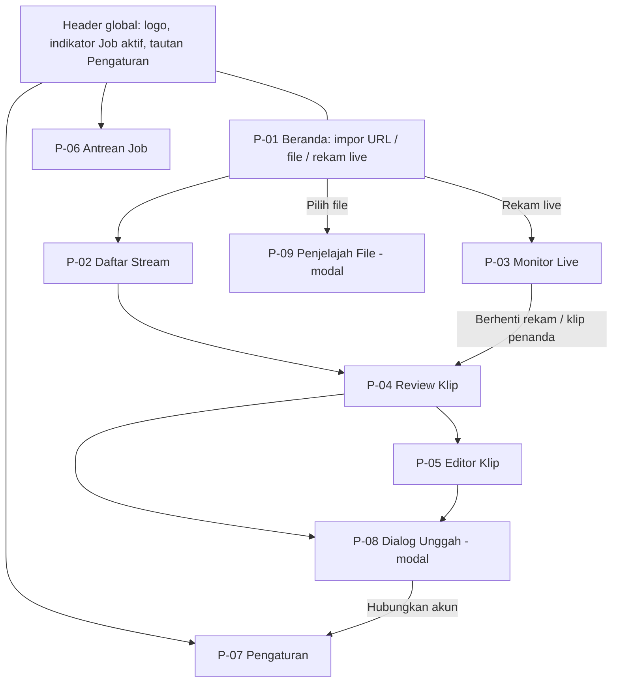

# UI/UX & Daftar Halaman: Klipin
> Versi 1.1 · 2026-11-20 · Status: Draf · Dokumen terkait: 01-prd.md, 02-requirements.md, 03-user-flow.md, 06-api.md, 07-integrasi.md

## 1. Prinsip Desain
1. **Review cepat adalah inti.** Pengguna menilai puluhan Kandidat Klip per stream. Setujui/Tolak/putar harus bisa dikerjakan dengan keyboard tanpa membuka halaman lain (target: ≤ 10 detik keputusan per klip).
2. **Pratinjau 9:16 selalu terlihat.** Setiap perubahan layout, Region Cam, atau subtitle langsung tampil di pratinjau vertikal, tanpa harus render dulu (ADR-005). Ada "Pratinjau render 5 detik" untuk hasil yang persis.
3. **Proses panjang tidak menghalangi kerja.** Unduh, transkripsi, dan render berjalan di latar belakang. Progres selalu terlihat di header, dan Pengguna tetap bisa mereview stream lain.
4. **Jujur soal biaya & batasan.** Durasi audio yang akan dikirim ke API, skor parsial, dan batasan platform (mis. "dipaksa private") ditampilkan apa adanya, tidak disembunyikan.
5. **Layar desktop, tema gelap.** Dipakai di laptop/PC (≥ 1280×720) berdampingan dengan video. Tema gelap mengurangi silau dan membuat warna video lebih akurat.

## 2. Peta Halaman

Routing SPA memakai hash (`/#/...`): `/#/` (P-01), `/#/streams` (P-02), `/#/streams/:id/live` (P-03), `/#/streams/:id` (P-04), `/#/clips/:id/edit` (P-05), `/#/jobs` (P-06), `/#/settings?tab=` (P-07). P-08 dan P-09 adalah modal.

## 3. Daftar Halaman
| ID | Halaman | Peran | Komponen utama | FR |
|---|---|---|---|---|
| P-01 | Beranda | Pengguna | Kolom URL + tombol Impor VOD / Rekam Live, kartu metadata hasil inspect, tombol Pilih file, daftar 5 stream terakhir, banner pengingat izin konten | FR-001, FR-002, FR-003, FR-022 |
| P-02 | Daftar Stream | Pengguna | Tabel Stream Sumber (judul, Kanal, platform, durasi, status, jumlah Klip per status, ukuran file), filter status, aksi hapus video sumber / hapus stream | FR-024, FR-001 |
| P-03 | Monitor Live | Pengguna | Player near-live (hls.js), indikator durasi rekaman & delay, tombol Klip N detik terakhir / Tandai Mulai–Selesai / Berhenti Rekam, panel Penanda Live & Kandidat Klip live | FR-003, FR-004, FR-013 |
| P-04 | Review Klip | Pengguna | Header stream + progres pipeline, timeline heatmap Sinyal, daftar Klip (kartu skor/kategori/alasan/badge unggah), pratinjau 9:16, tombol Setujui/Tolak/Edit/Render/Unggah, buat Klip manual dari timeline, Hitung ulang skor | FR-012, FR-014, FR-018 |
| P-05 | Editor Klip | Pengguna | Pratinjau 9:16 besar, trim dengan jepret ke batas kalimat, pemilih Preset Layout, editor Region Cam di atas frame sumber, editor subtitle per kata/baris, pemilih Gaya Subtitle & Bahasa Tampil, judul, Pratinjau render 5 detik | FR-007, FR-008, FR-015, FR-016, FR-017 |
| P-06 | Antrean Job | Pengguna | Daftar Job aktif (progres, tahap) & riwayat, filter jenis/status, detail log, Batalkan / Coba lagi / Konfirmasi pemakaian | FR-023, FR-022 |
| P-07 | Pengaturan | Pengguna | Tab: Umum, API & Penyedia, Skor Highlight, Akun Unggah, Caption, Gaya Subtitle, Sistem | FR-019, FR-021, FR-008, FR-017, FR-027 |
| P-08 | Dialog Unggah (modal) | Pengguna | Daftar Platform Tujuan + status, toggle Mode Unggah manual/otomatis, editor judul/caption/hashtag per platform, visibilitas (otomatis), Paket Unggah, Tandai sudah diposting | FR-020, FR-025, FR-026, FR-027 |
| P-09 | Penjelajah File (modal) | Pengguna | Navigasi folder lokal, daftar file video + ukuran, opsi salin ke folder kerja | FR-002 |

Setiap FR di 02-requirements.md punya minimal satu halaman. FR-005, FR-006, FR-009, FR-010, FR-011 berjalan otomatis di latar belakang; hasilnya tampil di P-04 dan progresnya di P-06.

## 4. Detail Halaman Kunci

### P-01 Beranda
- **Tujuan:** memulai pekerjaan dalam ≤ 3 klik.
- **Elemen:**
  - Kolom besar "Tempel link VOD atau live YouTube/Kick". Saat ditempel, otomatis memanggil `POST /streams/inspect` (debounce 500 ms).
  - Kartu hasil inspect: thumbnail frame, judul, Kanal (badge "Kanal dikenal: preset Gaming tersimpan" jika ada), durasi, status live, chat replay tersedia/tidak, perkiraan ukuran vs ruang disk.
  - Tombol utama berganti sesuai status: **"Impor VOD"** atau **"Mulai Rekam Live"** (+ centang "Analisis selama live").
  - Tombol sekunder "Pilih file dari komputer" → P-09.
  - Daftar 5 Stream Sumber terakhir (status + progres).
  - Banner kecil yang bisa ditutup: "Pastikan kamu punya izin untuk mengklip stream ini."
- **State:**
  - Kosong: ilustrasi sederhana + contoh format link.
  - Memuat (inspect): skeleton kartu + "Membaca info video…".
  - Error: pesan dari API (URL tidak dikenali / yt-dlp gagal + tombol "Perbarui yt-dlp").
  - Sukses: kartu metadata + tombol aksi aktif.
- **Aksi & validasi:** ruang disk kurang → tombol Impor nonaktif + teks kebutuhan ruang. URL live dengan "Impor VOD" → saran Rekam Live. Setelah Impor → pindah ke P-04 stream itu (menampilkan progres pipeline).

### P-03 Monitor Live
- **Tujuan:** menangkap momen saat live dengan satu tombol.
- **Tata letak:** kiri 65% player (16:9) dengan label "LIVE · terekam 01:23:45 · delay ±15 dtk"; kanan 35% panel tab "Penanda" dan "Kandidat Klip".
- **Elemen:**
  - Tombol besar **"Klip 60 detik terakhir"** (angka bisa diganti: 15/30/60/90, ingat pilihan terakhir).
  - Tombol "Tandai Mulai" → berubah menjadi "Tandai Selesai (00:42)" dengan penghitung berjalan.
  - Tombol "Berhenti Rekam" (konfirmasi).
  - Indikator celah koneksi ("Terputus 00:12, menyambung ulang…").
  - Kartu Kandidat Klip baru muncul di panel kanan (event `clip.created`), bisa langsung "Setujui" atau dibuka di P-05.
- **State:**
  - Memuat: "Menunggu segmen pertama…" (≤ 30 detik).
  - Error: "Stream tidak sedang live" / "Rekaman berhenti: koneksi terputus > 60 detik. Segmen yang ada sedang diproses."
  - Sukses: player berjalan.
  - Selesai: banner "Rekaman selesai, memproses… Lihat hasil" → P-04.
- **Aksi & validasi:** "Klip N detik terakhir" saat rekaman < N detik → toast "Rekaman baru 20 detik". Tandai Selesai > 90 detik → toast peringatan "Durasi melebihi 90 detik, perlu di-trim".

### P-04 Review Klip
- **Tujuan:** memutuskan Klip mana yang layak secepat mungkin.
- **Tata letak (tiga kolom):**
  - Kiri (320 px): daftar kartu Klip.
  - Tengah: pratinjau 9:16 (tinggi penuh viewport, maks. 720 px) + kontrol putar.
  - Kanan (300 px): rincian Klip.
  - Bawah selebar halaman: timeline heatmap.
- **Elemen:**
  - **Header stream:** judul, Kanal, durasi, bahasa terdeteksi, progres pipeline per tahap (Unduh ✓ · Layout ✓ · Transkripsi 45% · Skor ○). Banner "Menunggu konfirmasi transkripsi" + tombol buka dialog FR-022 bila tertahan.
  - **Kartu Klip:** skor (angka besar, warna sesuai rentang), kategori (chip), durasi, waktu di stream (`01:02:13`), alasan 1 baris, badge asal (Auto / Penanda Live / Manual), badge "skor parsial", badge status (Disetujui/Ditolak/Dirender), badge unggah per platform (ikon + status: ✓ terposting, ⏳ menunggu ditandai, ⚠ gagal, 🔒 private).
  - **Filter & urutan:** status (default semua kecuali Ditolak), urut skor/waktu, kategori.
  - **Rincian (kanan):** rincian Sinyal (Audio, Chat, LLM, atau "tidak tersedia"), alasan lengkap, judul, Preset Layout aktif, tombol Setujui / Tolak / Edit / Render / Unggah / Unduh MP4 / Buka folder.
  - **Timeline heatmap:** garis per Sinyal (audio, chat, LLM) per 30 detik; blok Klip di atasnya (warna per status); klik = lompat pratinjau ke waktu itu; seret rentang = "Buat Klip dari sini" (15–90 detik).
  - **Aksi massal:** "Render semua yang disetujui", "Hitung ulang skor".
- **State:**
  - Kosong (pipeline berjalan): skeleton daftar + "Kandidat Klip muncul setelah transkripsi & skor selesai".
  - Kosong (selesai, 0 kandidat): "Tidak ada momen menonjol. Coba turunkan ambang skor di Pengaturan atau buat klip manual dari timeline."
  - Memuat: skeleton.
  - Error: kartu Job gagal + "Coba lagi" + tautan ke P-06.
  - Sukses: daftar terisi, Klip teratas otomatis terpilih.
- **Aksi & validasi:** Setujui Klip dengan durasi di luar 15–90 detik → tombol nonaktif + tooltip "Trim dulu (durasi 1:42)". Render Klip `candidate` → tidak tersedia (tombol tersembunyi). Video sumber dihapus → banner "Video sumber dihapus; hanya Klip yang sudah dirender yang tersedia."

### P-05 Editor Klip
- **Tujuan:** merapikan satu Klip sampai siap render.
- **Tata letak:** kiri pratinjau 9:16; kanan panel tab "Layout", "Subtitle", "Info"; bawah trimmer.
- **Elemen:**
  - **Trimmer:** filmstrip + waveform rentang Klip ± 30 detik, pegangan awal/akhir (langkah 0,1 detik, tombol panah), toggle "Jepret ke batas kalimat" (default aktif), label durasi berwarna merah jika di luar 15–90 detik.
  - **Tab Layout:**
    - Kartu Preset Layout bergambar (Gaming, Podcast, IRL, Dua Orang, Crop Tengah, Kustom).
    - Editor Region Cam: frame sumber 16:9 dengan kotak yang bisa digeser/diubah ukurannya, berlabel `cam`/`content`/`face_a`/`face_b`. Asal region ditandai ("dari Kanal", "hasil deteksi", "khusus klip ini").
    - Centang "Simpan sebagai default Kanal ini" + "Terapkan ke semua klip stream ini".
    - Slider parameter preset (mis. tinggi cam 25–50%).
  - **Tab Subtitle:**
    - Pemilih Gaya Subtitle (thumbnail).
    - Pemilih Bahasa Tampil (muncul hanya jika bahasa sumber bukan Indonesia), dengan catatan "Terjemahan memakai mode kalimat".
    - Daftar baris subtitle: setiap kata bisa diklik untuk diedit, disembunyikan, atau diberi pemisah baris; kata dengan confidence rendah (< 0,6) digarisbawahi kuning.
    - Tombol "Kembalikan ke transkrip asli".
  - **Tab Info:** judul (≤ 100), kategori, alasan LLM (baca saja).
  - Tombol: "Pratinjau render 5 detik" (memutar hasil render asli di posisi playhead), "Setujui & kembali", "Render".
  - Indikator simpan otomatis ("Tersimpan" / "Menyimpan…").
- **State:**
  - Memuat: skeleton pratinjau.
  - Error simpan: toast "Gagal menyimpan, mencoba lagi…" + tombol ulang.
  - Klip `rendering`: editor terkunci + "Sedang dirender…".
  - Klip `rendered` diedit: banner "Perlu render ulang".
- **Aksi & validasi:** Region Cam di luar frame atau terlalu kecil → kotak merah + pesan validasi; "Simpan default Kanal" pada stream tanpa Kanal → minta pilih/buat Kanal (dropdown + "Kanal baru").

### P-08 Dialog Unggah (modal)
- **Tujuan:** memposting satu Klip ke beberapa platform, manual atau otomatis.
- **Elemen:**
  - Daftar 4 Platform Tujuan (YouTube, TikTok, Instagram, Facebook), masing-masing sebagai baris yang bisa dibuka:
    - Centang platform. Platform dengan Unggahan aktif/berhasil tidak bisa dicentang dan menampilkan statusnya + tautan postingan.
    - Toggle segmented **Manual | Otomatis**. Otomatis nonaktif jika ada `auto_blockers`, dengan teks alasan dan tautan: "Hubungkan akun", "Isi kredensial aplikasi (panduan)", "Durasi melebihi batas platform".
    - Editor teks: judul (YouTube saja, penghitung 0/100), caption (penghitung sesuai batas platform), chip hashtag (tambah/hapus), template tetap (baca saja, dari Pengaturan).
    - Visibilitas (hanya Otomatis): opsi dari `visibility_options`; jika dipaksa private tampil 🔒 + alasan (mis. "Aplikasi TikTok kamu belum diaudit").
    - Tombol "Buat ulang draf" (FR-027).
  - Tombol utama **"Siapkan & Kirim"** (label menyesuaikan: "Siapkan paket" jika semua manual).
  - **Setelah dikirim, per platform:**
    - Manual → kartu **Paket Unggah**: "Unduh MP4", "Unduh .srt", caption lengkap dengan tombol "Salin", "Salin judul" (YouTube), "Buka halaman upload {Platform}" (tab baru), "Buka folder", kolom URL postingan + **"Tandai sudah diposting"**, tautan "Batalkan".
    - Otomatis → baris progres (Mengunggah 40% → Memproses di platform → Terposting + tautan), atau gagal + "Coba lagi" / "Unggah manual saja".
- **State:**
  - Memuat draf caption: skeleton teks + "Menyiapkan caption…" (≤ 15 detik). Teks tetap bisa diketik.
  - Draf gagal: template default + info "Draf otomatis tidak tersedia".
  - Error validasi: pesan di bawah field terkait (path `items[n]`).
  - Sukses: kartu Paket Unggah / progres.
- **Aksi & validasi:** tombol kirim nonaktif jika tidak ada platform dicentang atau ada field tidak valid; URL postingan manual divalidasi domain sebelum "Tandai sudah diposting".

### P-07 Pengaturan
| Tab | Isi | FR |
|---|---|---|
| Umum | Folder kerja & output, mode unggah default, jumlah Job berat paralel, durasi default "Klip N detik terakhir", ukuran segmen & blok live | FR-021 |
| API & Penyedia | Pilih penyedia transkripsi & LLM, model LLM per tugas, isi API key (termasking) + "Tes koneksi", konfirmasi pemakaian > N menit, batas durasi audio per Job, tautan halaman harga | FR-021, FR-022 |
| Skor Highlight | Slider bobot Audio/Chat/LLM (total 100%), ambang skor minimum, Jeda Chat, kata reaksi chat (chip), toggle "Ambil chat live Kick (eksperimental)" | FR-021, FR-010 |
| Akun Unggah | Kartu per platform: status (Belum dikonfigurasi / Belum terhubung / Terhubung: nama / Bermasalah), tombol Hubungkan/Putuskan, pemilihan Halaman FB / akun IG setelah OAuth, peringatan batasan (dipaksa private, kuota), panduan kredensial aplikasi developer | FR-019 |
| Caption | Template tetap per platform, URL halaman upload manual per platform | FR-027, FR-025 |
| Gaya Subtitle | Daftar gaya + pratinjau, gandakan/ubah/hapus (gaya bawaan hanya bisa digandakan) | FR-017 |
| Sistem | Hasil `system/health` (FFmpeg, yt-dlp, keyring, SQLite), tombol "Perbarui yt-dlp", ruang disk, lokasi backup | FR-021 |

### P-06 Antrean Job (ringkas)
- Tabel: jenis (ikon), objek (judul stream/klip), status, progres bar + tahap, mulai, durasi.
- Baris bisa dibuka → `log_tail` monospace + pesan error.
- Aksi per baris: Batalkan / Coba lagi / Konfirmasi pemakaian (dialog berisi durasi audio, perkiraan jendela LLM, pilihan "proses semua" atau "rentang tertentu").
- State kosong: "Tidak ada Job berjalan."

### P-09 Penjelajah File (ringkas)
- Breadcrumb path, daftar folder + file video (ikon, nama, ukuran, tanggal).
- Klik dua kali folder = masuk; pilih file → "Impor" (+ centang "Salin ke folder kerja").
- File > 20 GB / tanpa audio → pesan validasi setelah dipilih.

## 5. Design Token Dasar
| Token | Nilai | Pemakaian |
|---|---|---|
| `color.bg` | `#0F1115` | Latar aplikasi |
| `color.surface` | `#181B21` | Kartu, panel |
| `color.surface-2` | `#222630` | Hover, input |
| `color.border` | `#2E3340` | Garis pemisah |
| `color.text` | `#E8EAF0` | Teks utama (kontras ≥ 13:1 di `bg`) |
| `color.text-muted` | `#A0A6B4` | Teks sekunder (kontras ≥ 7:1 di `bg`) |
| `color.primary` | `#7C5CFF` | Tombol utama, fokus, seleksi |
| `color.success` | `#2FBF71` | Disetujui, terposting, skor ≥ 70 |
| `color.warning` | `#F2B233` | Skor 40–69, parsial, menunggu ditandai, confidence rendah |
| `color.danger` | `#F25555` | Ditolak, gagal, durasi tidak valid |
| `color.live` | `#FF3B5C` | Indikator LIVE & tombol penanda |
| `color.signal.audio` / `.chat` / `.llm` | `#4FC3F7` / `#FFB74D` / `#BA68C8` | Garis heatmap timeline |
| `font.ui` | Inter, system-ui, sans-serif | Antarmuka |
| `font.mono` | JetBrains Mono, ui-monospace | Log, timestamp |
| `font.size` | 12 / 14 (dasar) / 16 / 20 / 28 px | Skala teks |
| `space` | 4 / 8 / 12 / 16 / 24 / 32 px | Skala spacing |
| `radius` | 6 px (input), 10 px (kartu), 999 px (chip) | Sudut |
| `motion` | 150 ms ease-out | Transisi hover/panel; hormati `prefers-reduced-motion` |

Warna platform hanya dipakai pada ikon platform (logo resmi tidak diubah). Font subtitle di hasil render diatur Gaya Subtitle, bukan token UI.

## 6. Responsif & Aksesibilitas
- **Breakpoint:** utama ≥ 1280 px (tiga kolom P-04). Pada 1024–1279 px panel rincian P-04 dilipat menjadi laci; < 1024 px tampil pesan "Klipin dirancang untuk layar ≥ 1024 px" tetapi tetap bisa dipakai satu kolom.
- **Keyboard (NFR-009):**
  | Tombol | Aksi | Halaman |
  |---|---|---|
  | `Spasi` | Putar/jeda | P-03, P-04, P-05 |
  | `J` / `K` | Klip berikutnya / sebelumnya | P-04 |
  | `A` | Setujui | P-04, P-05 |
  | `X` | Tolak | P-04 |
  | `E` | Buka editor | P-04 |
  | `R` | Render | P-04, P-05 |
  | `U` | Buka Dialog Unggah | P-04 (Klip dirender) |
  | `[` / `]` | Set awal/akhir trim di playhead | P-05 |
  | `←` / `→` | Geser playhead 1 detik (`Shift` = 0,1 detik) | P-04, P-05 |
  | `M` | Klip N detik terakhir | P-03 |
  | `?` | Tampilkan daftar pintasan | Semua |
- Pintasan tidak aktif saat fokus di input teks.
- Fokus terlihat (outline 2 px `color.primary`), urutan tab logis, semua tombol ikon punya `aria-label`, toast memakai `role="status"`, modal mengunci fokus dan bisa ditutup `Esc`.
- Kontras teks ≥ WCAG AA (4,5:1); status tidak hanya dibedakan warna (selalu ada ikon/teks).
- Target klik ≥ 32 px (aplikasi desktop dengan mouse); tombol utama ≥ 40 px.

## 7. Teks Penting
| Situasi | Teks |
|---|---|
| URL tidak dikenali | "URL tidak dikenali. Gunakan link VOD YouTube atau Kick." |
| Stream masih live saat Impor VOD | "Stream ini masih live. Gunakan Rekam Live?" |
| Ruang disk kurang | "Butuh ±9,6 GB, tersedia 4,1 GB. Kosongkan ruang atau hapus video sumber lama." |
| Konfirmasi pemakaian API | "Audio yang dikirim ke API transkripsi: 2 jam 10 menit (±260 jendela dinilai AI). Cek harga di situs penyedia. Lanjutkan?" |
| API key kosong | "API key transkripsi belum diisi atau tidak valid. Buka Pengaturan." |
| 0 Kandidat Klip | "Tidak ada momen menonjol. Coba turunkan ambang skor atau buat klip manual dari timeline." |
| Skor parsial | "Skor parsial: sinyal chat/AI tidak tersedia untuk bagian ini." |
| Wajah tidak terdeteksi | "Wajah tidak terdeteksi. Tandai area kamera manual jika ada." |
| Durasi tidak valid | "Durasi klip harus 15–90 detik." |
| Render sebelum setuju | "Setujui klip dulu sebelum render." |
| Perlu render ulang | "Klip diubah setelah dirender. Render ulang agar file terbaru." |
| Konfirmasi hapus video sumber | "Hapus video sumber (6,0 GB)? 3 klip belum dirender dan tidak bisa dirender setelah ini. Klip yang sudah dirender tetap aman." |
| Konfirmasi hapus stream | "Hapus stream ini beserta transkrip dan semua klipnya? File di folder output tidak ikut terhapus." |
| Unggah: otomatis tidak tersedia | "Hubungkan akun {Platform} dulu untuk unggah otomatis." |
| Unggah: dipaksa private | "🔒 {Platform} akan memposting sebagai private karena aplikasimu belum diaudit." |
| Unggah: sudah ada | "Klip ini sudah/sedang diunggah ke {Platform}." |
| Paket Unggah siap | "Paket siap. Unduh video, salin caption, lalu posting di {Platform}. Jangan lupa tandai sudah diposting." |
| Caption tersalin | "Tersalin" |
| URL postingan salah | "URL tidak sesuai platform {Platform}." |
| Token kedaluwarsa | "Koneksi {Platform} kedaluwarsa. Hubungkan ulang di Pengaturan." |
| Sukses unggah otomatis | "Terposting di {Platform}. Lihat postingan" |
| yt-dlp gagal | "Gagal membaca video. Situs mungkin berubah, coba Perbarui yt-dlp di Pengaturan." |
| Pengingat izin konten | "Pastikan kamu punya izin untuk mengklip dan memposting ulang stream ini." |

## Asumsi & Pertanyaan Terbuka
- [ASUMSI] Tema gelap saja untuk MVP; tema terang bisa ditambah lewat token yang sama.
- [ASUMSI] Antarmuka berbahasa Indonesia saja (pengguna tunggal berbahasa Indonesia).
- [ASUMSI] Ikon platform memakai aset logo resmi sesuai pedoman merek masing-masing platform; dicek saat implementasi.
- Waveform di trimmer memakai `GET /streams/{id}/waveform`; tombol "Buka folder" memakai `POST /system/open-folder` (06-api.md).
- [TANYA] Apakah perlu mode "review cepat" layar penuh (satu Klip per layar, hanya pratinjau + A/X)? (Pengguna)
- [TANYA] Apakah notifikasi desktop OS diinginkan saat pipeline/unggah selesai (terkait 03-user-flow.md)? (Pengguna)

## Riwayat Perubahan
| Versi | Tanggal | Perubahan |
|---|---|---|
| 1.0 | 2026-11-20 | Draf awal |
| 1.1 | 2026-11-20 | Hasil CEK #2, #10: rujukan endpoint waveform & buka folder |
