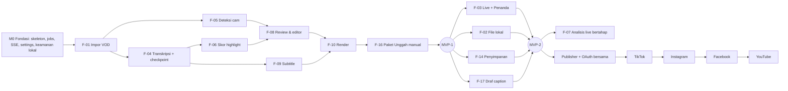

# Roadmap & Milestone: Klipin
> Versi 1.0 · 2026-11-20 · Status: Draf · Dokumen terkait: 01-prd.md, 02-requirements.md, 04-arsitektur.md, 07-integrasi.md, 09-testing.md

Ukuran relatif: **S** ≈ 1–3 hari kerja, **M** ≈ 1–2 minggu, **L** ≈ 3–4 minggu untuk satu pengembang solo. Tanggal tidak ditetapkan karena belum diberikan Pengguna.

## 1. Fase
| Fase | Isi (F-xx) | Kriteria selesai | Ukuran relatif |
|---|---|---|---|
| **M0 Fondasi** | Kerangka proyek (FastAPI + React/Vite + SQLite/Alembic), Worker & tabel `jobs`, token sesi API lokal (ADR-009), keyring, `klipin doctor`, SSE, F-13 (Pengaturan dasar + API key), F-15 (Antrean Job) | `klipin start` jalan di Windows & macOS; Job dummy terlihat progresnya di P-06; TC-041, TC-042, TC-045–TC-047, TC-070–TC-075 lulus | M |
| **MVP-1 Klip dari VOD** | F-01 Impor VOD, F-04 Transkripsi, F-05 Deteksi cam & Preset Layout, F-06 Deteksi Kandidat Klip, F-08 Review & edit, F-09 Subtitle, F-10 Render, F-16 Mode Unggah **manual** (Paket Unggah + tandai diposting) | Dari URL VOD YouTube sampai MP4 9:16 bersubtitle + Paket Unggah tersalin; TC-001–TC-004, TC-011–TC-043, TC-048, TC-049–TC-055 lulus; A/B transkripsi selesai; evaluasi kualitas putaran 1 | L |
| **MVP-2 Live & kenyamanan** | F-03 Rekam & pantau live + Penanda Live, F-02 Impor file lokal, F-14 Manajemen penyimpanan, F-17 Draf caption per platform | Rekam live YouTube/Kick, "Klip 60 detik terakhir" jadi Kandidat Klip ≤ 2 menit; TC-005–TC-010, TC-062–TC-063 lulus | M |
| **v1.1 Otomasi** | F-07 Analisis live bertahap; kerangka `Publisher` + F-12 TikTok (INT-10) → F-12 Instagram (INT-11) → F-12 Facebook (INT-12) → F-11 YouTube (INT-07); INT-03 chat live Kick (eksperimental) | Setiap platform: OAuth terhubung, satu unggahan private berhasil, error audit/token dipetakan ke pesan yang jelas, "Unggah manual saja" berfungsi; TC-056–TC-061, TC-064 lulus | L |
| **v2 (ide, belum dijadwalkan)** | Transkripsi lokal (Whisper, jika ada GPU), penjadwalan posting, banyak akun per platform, klip 16:9, mode review layar penuh, notifikasi desktop | Ditentukan saat direncanakan | — |

Urutan platform di v1.1 (TikTok → Instagram → Facebook → YouTube) adalah default [ASUMSI]: TikTok & Reels adalah tujuan utama konten vertikal, sedangkan unggah otomatis YouTube paling terbatas tanpa audit (F-11 Could). Urutan bisa ditukar tanpa mengubah desain karena semua lewat antarmuka `Publisher`.

## 2. Urutan Pengerjaan & Ketergantungan

Alasan urutan:
1. **M0 dulu** karena semua fitur bergantung pada antrean Job, SSE, penyimpanan rahasia, dan proteksi API lokal. Memasang keamanan belakangan berisiko terlupa.
2. **Transkripsi sebelum skor dan subtitle:** Kata Transkrip adalah bahan Sinyal LLM, batas kalimat, dan subtitle.
3. **Deteksi cam paralel dengan transkripsi:** tidak saling bergantung; bisa dikerjakan bergantian saat menunggu hasil A/B transkripsi.
4. **Render sebelum unggah:** BR-007. Paket Unggah manual cukup untuk MVP karena tidak butuh aplikasi developer atau audit platform.
5. **Live setelah VOD:** rekam live memakai ulang seluruh pipeline VOD (segmen digabung → pipeline sama); hanya menambah perekam, player near-live, dan Penanda Live.
6. **Otomasi unggah terakhir:** paling bergantung pada pihak luar (pembuatan aplikasi developer, audit, perubahan API). Nilai produk sudah tercapai tanpa otomasi.

## 3. Risiko Jadwal
| Risiko | Dampak ke jadwal | Mitigasi |
|---|---|---|
| Kualitas skor highlight rendah di evaluasi putaran 1 | MVP-1 molor untuk tuning prompt/bobot | Bobot & ambang bisa diatur di Pengaturan; cache `highlight_windows` membuat iterasi murah; tetapkan batas 1 minggu tuning, sisanya masuk backlog |
| yt-dlp rusak karena perubahan YouTube/Kick saat pengembangan | Blokir pengujian impor | Simpan fixture lokal; F-02 impor file lokal bisa dipercepat sebagai jalan pintas |
| Deteksi pembicara aktif (preset `podcast`) sulit akurat | Fitur podcast molor | Rilis `split_two` dan `center_crop` dulu; `podcast` dinamis boleh menyusul di MVP-2 |
| Instalasi MediaPipe/FFmpeg di Windows bermasalah | M0 molor | `klipin doctor` sejak M0; fallback detektor wajah OpenCV DNN (04-arsitektur.md) |
| Pembuatan aplikasi developer TikTok/Meta & review butuh waktu (di luar kendali) | v1.1 tertunda | Ajukan aplikasi developer lebih awal (paralel dengan MVP-2); mode manual tetap tersedia |
| Perubahan API platform sosial media | Adapter rusak setelah rilis | Tes kontrak dengan fixture; satu adapter per platform; smoke test sebelum rilis |
| Biaya API membengkak saat pengembangan | Pengembangan dihentikan sementara | `KLIPIN_PROVIDERS=fake` untuk tes; Set Evaluasi kecil; konfirmasi pemakaian aktif |

## 4. Definition of Done
- [ ] Kriteria penerimaan FR terkait (02-requirements.md) lulus, beserta TC di 09-testing.md.
- [ ] Constraint DB baru punya migrasi Alembic dan diuji (insert valid & tidak valid).
- [ ] Endpoint baru sesuai 06-api.md (kode error, token sesi, validasi).
- [ ] Tidak ada API key/token di log, respons, atau repo (TC-075).
- [ ] Teks UI sesuai 08-ui-ux.md bagian 7; aksi utama punya pintasan keyboard bila disebut.
- [ ] Diuji manual di laptop acuan (Windows dan/atau macOS) dengan alur yang terdampak.
- [ ] Dokumentasi diperbarui: dokumen spesifikasi terdampak (versi naik + Riwayat Perubahan) dan README instalasi bila ada prasyarat baru.

## Asumsi & Pertanyaan Terbuka
- [ASUMSI] Satu pengembang solo; ukuran relatif dihitung untuk itu dan belum termasuk waktu belajar teknologi baru.
- [ASUMSI] Urutan platform otomatis v1.1: TikTok → Instagram → Facebook → YouTube.
- [ASUMSI] Kriteria MVP adalah penggunaan pribadi; tidak ada rilis publik.
- [TANYA] Target tanggal MVP-1? Jika ada, ditambahkan Gantt di dokumen ini. (Pengguna)
- [TANYA] Konfirmasi urutan prioritas platform untuk unggah otomatis. (Pengguna)

## Riwayat Perubahan
| Versi | Tanggal | Perubahan |
|---|---|---|
| 1.0 | 2026-11-20 | Draf awal |
